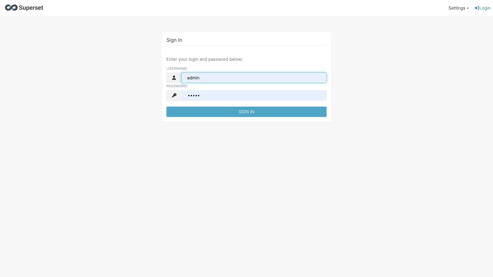
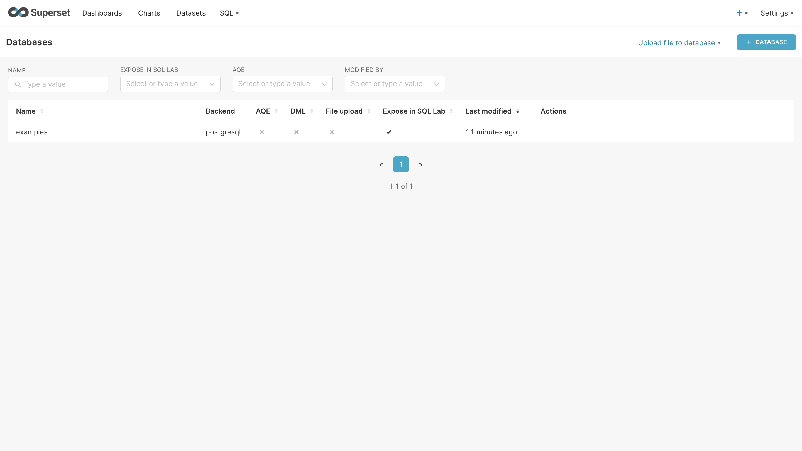
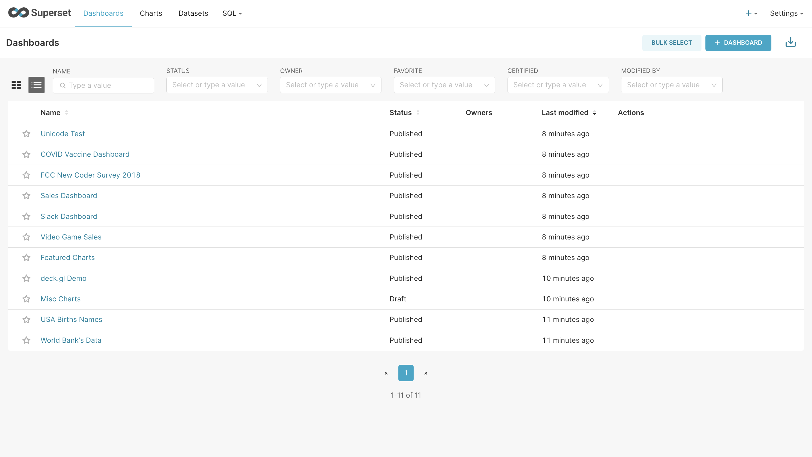

根据官方[Quick Start Guide](https://superset.apache.org/docs/quickstart/)，你可以按照以下步骤进行部署：

- [1. 确认环境](#1-确认环境)
- [2. 获取代码](#2-获取代码)
- [3. 获取官方最新代码](#3-获取官方最新代码)
- [4. 启动服务](#4-启动服务)
- [5. 访问Superset Web界面](#5-访问superset-web界面)
- [6. 接入数据源](#6-接入数据源)

前提条件：

- docker
- docker compose

## 1. 确认环境

安装Docker和Docker Compose  
确保你的系统上已安装 Docker 和 Docker Compose。可以通过以下命令验证是否已正确安装：

```bash
   docker --version
   docker-compose --version
```

## 2. 获取代码

```bash
git clone https://github.com/apache/superset.git
```

## 3. 获取官方最新代码

```bash
# Enter the repository you just cloned
$ cd superset

# Set the repo to the state associated with the latest official version
# 获取指定版本
$ git checkout tags/4.1.2

```

tags 对应版本，如果需要历史版本，比如`tags/3.0.4`

## 4. 启动服务

```bash
# Fire up Superset using Docker Compose
# 启动服务
#
$ docker compose -f docker-compose-non-dev.yml up
```

`docker-compose.yml` 是开发版本，生产版本选用 `docker-compose-non-dev.yml`文件

如果不想发布最新版本的superset，可以指定TAG 用于发布指定的版本，主要对应yml文件中的首行有效配置

```yml
x-superset-image: &superset-image apachesuperset.docker.scarf.sh/apache/superset:${TAG:-latest-dev}
```

可以通过以下方式指定：

```bash
export TAG=3.0.4

docker compose -f docker-compose-non-dev.yml up
#即可使用3.0.4版本的superset
```

docker-compose-non-dev.yml 的脚本启动后，可以看到将经历几个步骤

- 拉取镜像，这个环节也是最耗费时间的，
- 创建容器

```bash
[+] Running 7/7
 ⠿ Network superset_default Created                                                                                                                                                             0.1s
 ⠿ Container superset_db           Created                                                                                                                                                             0.2s
 ⠿ Container superset_cache        Created                                                                                                                                                             0.1s
 ⠿ Container superset_init         Created                                                                                                                                                             0.2s
 ⠿ Container superset_worker_beat  Created                                                                                                                                                             0.2s
 ⠿ Container superset_app          Created                                                                                                                                                             0.2s
 ⠿ Container superset_worker       Created                                                                                                                                                             0.2s
```

- 依次启动服务:superset_cache\superset_db(PG)\superset_worker_beat\superset_worker \superset_init\superset_app 
- superset_init 环节最为重要，做环境配置的初始化，需要经历4个阶段
  
```bash
Init Step 1/4 [Starting] -- Applying DB migrations
……
Init Step 1/4 [Complete] -- Applying DB migrations
……
Init Step 2/4 [Starting] -- Setting up admin user ( admin / admin )
……
Init Step 2/4 [Complete] -- Setting up admin user
……
Init Step 3/4 [Starting] -- Setting up roles and perms
……
Init Step 3/4 [Complete] -- Setting up roles and perms
……
Init Step 4/4 [Starting] -- Loading examples
……
Init Step 4/4 [Complete] -- Loading examples
```

- superset_app 是界面服务对应的容器

```bash
superset_app          | Skipping local overrides
superset_app          | Starting web app...
superset_app          | [2025-05-16 07:22:45 +0000] [8] [INFO] Starting gunicorn 22.0.0
superset_app          | [2025-05-16 07:22:45 +0000] [8] [INFO] Listening at: http://0.0.0.0:8088 (8)
superset_app          | [2025-05-16 07:22:45 +0000] [8] [INFO] Using worker: gthread
superset_app          | [2025-05-16 07:22:45 +0000] [9] [INFO] Booting worker with pid: 9
```

以上信息输出完整后，标记这Superset部署启动成功

清理资源：

```bash
$ docker compose -f docker-compose-non-dev.yml down
[+] Running 7/7
 ⠿ Container superset_app          Removed                                                                                                                                                             0.4s
 ⠿ Container superset_worker       Removed                                                                                                                                                             0.4s
 ⠿ Container superset_init         Removed                                                                                                                                                             0.5s
 ⠿ Container superset_worker_beat  Removed                                                                                                                                                             0.5s
 ⠿ Container superset_cache        Removed                                                                                                                                                             0.0s
 ⠿ Container superset_db           Removed                                                                                                                                                             0.0s
 ⠿ Network superset_default        Removed         
```

## 5. 访问Superset Web界面  

打开浏览器访问 `http://localhost:8088`，使用默认的管理员账户登录(admin/admin)。



## 6. 接入数据源

1. 配置数据源  
   登录后，在 **Data** 菜单下选择 **Data Sources > Databases**，点击 **+** 添加新的数据库连接。根据需要选择支持的数据源类型（如 MySQL、PostgreSQL、Manticore Search 等），并按照提示填写连接参数。



2. 创建仪表盘与可视化图表  
   - 导航到 **Data > Datasets**，选择已连接的数据源并导入数据集。
   - 点击 **Create > Dashboard** 创建一个新的仪表板。
   - 添加图表，通过 SQL 查询或可视化编辑器定义数据展示形式，并将其关联到仪表板。



3. 配置安全与权限（可选）  
   - 在 **Security** 菜单中管理用户角色和权限，确保数据访问的安全性。
   - 可以启用 OAuth 或 LDAP 认证以集成企业级身份验证。

4.  备份与维护（可选）  
    - 定期备份 Superset 数据库和配置文件。
    - 监控日志和性能指标，优化查询效率，确保长期稳定运行。

以上步骤可以快速部署并运行 Apache Superset，并连接多种数据源进行分析和可视化展示。