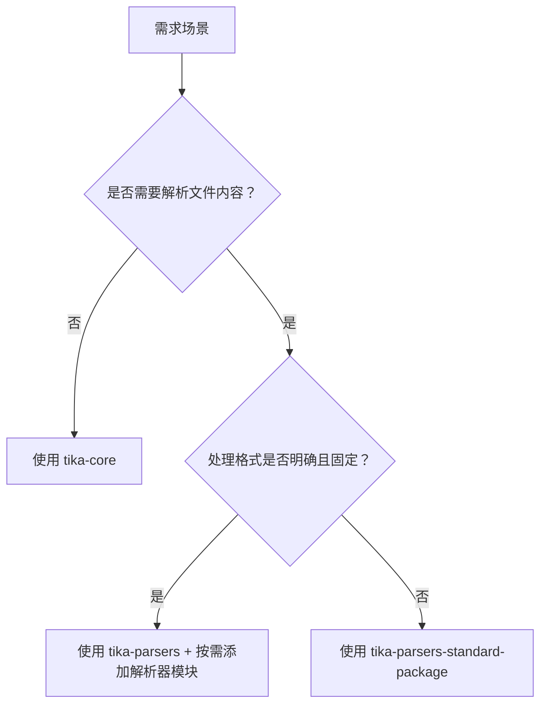

Apache Tika 的架构组件主要包括以下几个核心部分，它们共同协作，以支持从各种文件格式中提取文本、元数据和其他信息。以下是 Apache Tika 的主要架构组件：

- [**1.模块概览**](#1模块概览)
  - [Tika Core](#tika-core)
  - [Tika Parsers](#tika-parsers)
  - [Tika Config (配置管理)](#tika-config-配置管理)
  - [Tika App](#tika-app)
  - [Tika Server](#tika-server)
  - [Tika Language Detection](#tika-language-detection)
  - [Tika Extractor](#tika-extractor)
  - [Tika Metadata](#tika-metadata)
  - [Tika OCR (Optical Character Recognition)](#tika-ocr-optical-character-recognition)
- [**2. 核心模块功能对比**](#2-核心模块功能对比)
- [**3. 技术定位与使用场景**](#3-技术定位与使用场景)
    - [**(1) `tika-core`**](#1-tika-core)
    - [**(2) `tika-parsers`**](#2-tika-parsers)
    - [**(3) `tika-parsers-standard-package`**](#3-tika-parsers-standard-package)
- [**4. 选用决策树**](#4-选用决策树)
- [**5. 生产环境注意事项**](#5-生产环境注意事项)
- [**总结建议**](#总结建议)

## **1.模块概览**

### Tika Core

Tika Core 是 Apache Tika 的核心组件，提供了文件解析、内容提取的基础功能。它包含了最基本的功能，如文档类型识别、解析和提取文本内容。Tika Core 是其他功能和模块的基础。

- 文件解析（Parser）： 用于解析各种文件格式，返回提取的文本和元数据。
- 内容提取（Content Extraction）： 提取文件中的内容，包括文本、图片、音频、视频等。
- 文件类型识别（MIME Type Detection）： 根据文件的内容而不是扩展名，判断文件的实际类型（如 PDF、Word、Excel、HTML 等）。

### Tika Parsers

Tika Parsers 是一组负责解析不同类型文件的组件。它们是 Tika 核心的关键组成部分，能处理多种格式，如文本文档、电子表格、PDF、图像、音频等。Tika 会根据文件类型自动选择合适的解析器。

- 文本解析器（Text Parsers）： 解析普通文本文件（如 .txt、.xml、.html 等）。
- 多媒体解析器（Media Parsers）： 解析图片、音频、视频等多媒体文件。
- 文档解析器（Document Parsers）： 解析各类办公文档，如 Word、Excel、PowerPoint、PDF 等。
- 元数据解析器（Metadata Parsers）： 提取文件中的元数据，如作者、创建日期、修改日期、文件大小等。

### Tika Config (配置管理)

Tika Config 是用来管理 Tika 配置的模块，允许用户通过配置文件来定制 Tika 的行为。通过 Tika Config，用户可以指定特定的解析器、提取策略、字符集等设置。

配置文件： 可以通过 `tika-config.xml` 文件来配置如何解析不同类型的文件。
自定义解析器和扩展： 用户可以自定义自己的解析器，并通过配置文件将其加入到 Tika 系统中。

### Tika App

Tika App 是一个命令行工具，提供了一个易于使用的界面来调用 Tika 核心功能。Tika App 可以直接从命令行运行，用于文件内容提取、文本和元数据的提取。它可以作为独立应用，也可以嵌入到其他 Java 应用中。

命令行接口（CLI）： 提供简洁的命令行接口，允许用户从命令行处理文件。
文件处理： 支持批量文件处理，可以提取文本、元数据等信息，并输出到标准输出或文件中。

### Tika Server

Tika Server 是基于 RESTful API 的服务端组件，它允许通过 HTTP 协议进行远程调用。Tika Server 为外部应用提供了一个服务端接口，支持文件的上传、内容提取和处理。

- RESTful API： 通过 HTTP 请求与 Tika Server 交互，可以上传文件并获取解析后的内容或元数据。
- 远程解析： 支持异步处理大文件和批量文件，适合与其他系统集成（如搜索引擎、云存储服务等）。

### Tika Language Detection

Tika 还提供了内置的语言检测功能，用于自动识别提取文本的语言。语言检测对于多语言支持的项目非常有用，可以帮助在文件内容解析后识别出文本的语言类型，从而决定使用何种处理方式。

- 语言识别： 基于文本内容，自动检测文档的语言（如英语、中文、法语等）。
- 集成支持： 语言检测功能可与文本提取、内容分析等流程结合使用，提高内容的多语言处理能力。

### Tika Extractor

Tika Extractor 是一个抽象层，提供一种统一的接口来提取文件的内容。它将不同的文件解析器统一成一个接口，简化了对文件内容的提取过程。通过 Tika Extractor，用户可以在不同的文件类型间进行统一的操作，而无需关注具体的解析实现。

- 统一接口： 通过统一的接口来处理不同格式的文件，简化文件内容的提取流程。
- 自定义扩展： 允许开发者根据需求扩展提取器，支持更多的文件格式或自定义的内容提取逻辑。

### Tika Metadata

Tika Metadata 是用于管理文件元数据的组件。它提取并提供文件的各类元数据，如作者、创建时间、修改时间、版权信息、文件大小等。Tika 支持提取来自各种文件格式的元数据。

- 元数据提取： 从各种文件中提取出与文件相关的附加信息，如文件属性、作者、标题等。
- 统一格式： 返回标准化的元数据结构，方便与其他系统集成。

### Tika OCR (Optical Character Recognition)

Tika 集成了 OCR 功能，利用开源的 OCR 引擎（如 Tesseract）来提取图像中的文本信息。当文件中包含扫描图像或照片时，OCR 组件可以识别图像中的文字并进行提取。

- 图像文本识别： 提取图像或扫描文档中的文本内容。
- 集成与扩展： 可以与其他解析器结合，自动处理包含图像或扫描文档的文件。

以下是 `tika-core`、`tika-parsers` 和 `tika-parsers-standard-package` 三个 Maven 依赖的功能区别及选用建议，结合其设计定位和实际场景进行说明：

---

## **2. 核心模块功能对比**

| **模块名称**                  | **功能范围**                                                                 | **包含内容**                                                                 | **体积示例**       |
|-------------------------------|-----------------------------------------------------------------------------|-----------------------------------------------------------------------------|-------------------|
| **`tika-core`**               | **基础核心功能**                                                            | - 文件类型检测（MIME 数据库）<br>- 元数据提取框架<br>- 语言检测<br>- 基础文本提取接口 | ~1 MB             |
| **`tika-parsers`**            | **解析器抽象层**（*无具体实现*）                                            | - 定义 `Parser` 接口<br>- 抽象内容处理器（`ContentHandler`）<br>- **不包含任何格式的解析代码** | ~200 KB           |
| **`tika-parsers-standard-package`** | **全量解析器实现**（*预捆绑包*）                                            | 包含所有标准解析器（如 PDF、Office、图像等）及其依赖库（POI、PDFBox 等）               | **~80 MB**        |

---

## **3. 技术定位与使用场景**

#### **(1) `tika-core`**  
- **适用场景**：  
  - 仅需检测文件类型（如通过 `Tika.detect()` 判断上传文件是否为 PDF）。  
  - 提取基础元数据（如 MP3 文件的作者、时长）。  
  - **无需解析文件内容**的轻量级应用（如文件过滤网关）。  
- **优点**：  
  - 依赖极小，启动快，无兼容性冲突风险。  

#### **(2) `tika-parsers`**  
- **技术定位**：  
  - 提供解析器接口规范，**本身不具备解析能力**。  
  - 需**显式引入具体格式的解析器实现**（如 `tika-parser-pdf-module`）。  
- **适用场景**：  
  - 需**按需选择少数几种格式**（如仅处理 PDF 和 Word）。  
  - 对 Jar 包体积敏感（避免引入无用解析器）。  
- **示例 Maven 配置**：  
  ```xml
  <dependency>
      <groupId>org.apache.tika</groupId>
      <artifactId>tika-parsers</artifactId>
      <version>2.9.1</version>
  </dependency>
  <!-- 额外引入 PDF 解析器 -->
  <dependency>
      <groupId>org.apache.tika</groupId>
      <artifactId>tika-parser-pdf-module</artifactId>
      <version>2.9.1</version>
  </dependency>
  ```

#### **(3) `tika-parsers-standard-package`**  
- **适用场景**：  
  - 需处理**多种未知格式文件**（如文档管理系统、搜索引擎爬虫）。  
  - 不希望手动管理数十种解析器依赖。  
- **代价**：  
  - Jar 包体积巨大（含 POI、PDFBox、图像解析库等传递依赖）。  
  - 可能引发依赖冲突（如项目中已有旧版 POI）。  

---

## **4. 选用决策树**


---

## **5. 生产环境注意事项**
1. **依赖冲突解决**：  
   - 若使用 `standard-package` 后出现 `NoSuchMethodError`（如 POI 冲突）：  
     ```xml
     <!-- 排除冲突库，显式指定版本 -->
     <dependency>
         <groupId>org.apache.tika</groupId>
         <artifactId>tika-parsers-standard-package</artifactId>
         <version>2.9.1</version>
         <exclusions>
             <exclusion>
                 <groupId>org.apache.poi</groupId>
                 <artifactId>poi</artifactId>
             </exclusion>
         </exclusions>
     </dependency>
     <dependency>
         <groupId>org.apache.poi</groupId>
         <artifactId>poi</artifactId>
         <version>5.2.5</version> <!-- 使用项目兼容版本 -->
     </dependency>
     ```

2. **容器化优化**：  
   - 使用 `standard-package` 时，通过 Docker 分层构建分离依赖：  
     ```Dockerfile
     # 单独复制 Tika 依赖层（避免代码变更触发全量下载）
     COPY target/dependency/tika-parsers-standard-package.jar /app/libs/
     ```

3. **安全扫描**：  
   - `standard-package` 含多级传递依赖，需定期用 OWASP Dependency-Check 扫描漏洞（如 PDFBox 历史 CVE）。  

---

## **总结建议**
- **选 `tika-core`**：轻量元数据/类型检测场景（如文件上传校验）。  
- **选 `tika-parsers + 模块`**：明确处理少量格式且追求最小依赖（如仅解析 PDF 的微服务）。  
- **选 `tika-parsers-standard-package`**：全格式支持且可接受体积（如内容分析中台）。  

> 💡 **性能提示**：首次调用 `Tika.parse()` 时会加载所有解析器，在内存受限环境（如 Serverless）建议预热或异步初始化。
