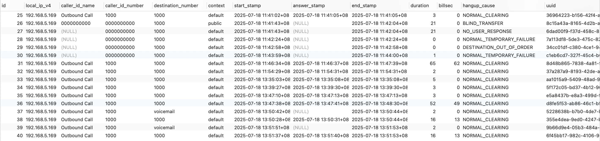

### 一、写话单方案

官方提供的组件有：

- mod_cdr_csv - saves a CSV file with the variables you specify in a template.
- mod_cdr_mongodb - saves detailed CDR data to a MongoDB database, in a format similar to mod_json_cdr.
- mod_odbc_cdr - saves any channel variable from call to your choice of ODBC database.
- mod_cdr_pg_csv - Asterisk Compatible CDR Module with PostgreSQL interface.
- mod_cdr_sqlite - saves directly to an sqlite DB with the variables you specify in a template.
- mod_json_cdr - Saves to file or POSTs a JSON representation of the channel variable and callflow. It can post directly to CouchDB.
- mod_xml_cdr - Saves to file or POSTs an XML representation of the channel variable and callflow.
- Xmlcdrd or JavaCDRLogger may assist you in saving the results.
- mod_radius_cdr - RADIUS CDR Module.
- CDR via ESL - Retrieve the CDR in an ESL event
- tiny_cdr from bougyman

从话单中，额外可以获取的信息：

- 通话开始振铃的时间(PDD)：ring_start_time = progress_time + progress_media_time
- 拨号后延迟：pdd = ring_start_time - created_time
- 对话的时长：length_of_talk_time = hangup_time - answered_time
- 振铃时长：
```
  if ( answered_time == 0 ) then
    length_of_phone_ringing = hangup_time - created_time
else
    length_of_phone_ringing = answered_time - created_time
end
```
- 挂起时长

#### 1. **数据库直写（推荐集群场景）**

   - **模块**：`mod_cdr_pg_csv`（PostgreSQL）或自定义模块（MySQL等）
   - **配置步骤**：
     - 引入pg写入模块，默认话单采用sqlite的方式存储，修改freeswitch/modules.conf，接下去，重新编译freeswitch，成功后即可使用
        ```conf
        databases/mod_pgsql
        event_handlers/mod_cdr_pg_csv
        ```
     - /usr/local/freeswitch/conf/autoload_configs/cdr_pg_csv.conf.xml  配置PG访问地址，所需写入字段。db的连接方式，可以具体参考lib包支持的书写方式： http://www.postgresql.org/docs/8.4/static/libpq-connect.html
        ```xml
<configuration name="cdr_pg_csv.conf" description="CDR PG CSV Format">
  <settings>
    <!-- See parameters for PQconnectdb() at http://www.postgresql.org/docs/8.4/static/libpq-connect.html -->
    <param name="db-info" value="postgresql://user:pass@ip:port/db?options=-c%20client_min_messages%3DNOTICE"/>
    <!-- CDR table name -->
    <param name="db-table" value="cdr"/>

    <!-- Log a-leg (a), b-leg (b) or both (ab) -->
    <param name="legs" value="a"/>

    <!-- Directory in which to spool failed SQL inserts -->
    <!-- <param name="spool-dir" value="$${log_dir}/cdr-pg-csv"/> -->
    <!-- Disk spool format if DB connection/insert fails - csv (default) or sql -->
    <param name="spool-format" value="csv"/>
    <param name="rotate-on-hup" value="true"/>

    <!-- This is like the info app but after the call is hung up -->
    <!--<param name="debug" value="true"/>-->
  </settings>
  <schema>
    <field var="local_ip_v4"/>
    <field var="caller_id_name"/>
    <field var="caller_id_number"/>
    <field var="destination_number"/>
    <field var="context"/>
    <field var="start_stamp"/>
    <field var="answer_stamp"/>
    <field var="end_stamp"/>
    <field var="duration" quote="false"/>
    <field var="billsec" quote="false"/>
    <field var="hangup_cause"/>
    <field var="uuid"/>
    <field var="bleg_uuid"/>
    <field var="accountcode"/>
    <field var="read_codec"/>
    <field var="write_codec"/>
    <field var="sip_hangup_disposition"/>
    <field var="ani"/>
  </schema>
</configuration>                        
```
        在数据库中扩展CDR表，添加自定义字段（如`queue_name`）：
       ```sql
       ALTER TABLE cdr ADD COLUMN queue_name VARCHAR(50);
       ```
     - 修改`cdr_pg_csv.conf.xml`，映射通道变量到数据库字段：
       ```xml
       <field name="queue_name" chan-var-name="cti_queue_name"/>
       ```
     - 在Dialplan中设置业务变量：
       ```xml
       <action application="set" data="cti_queue_name=Sales_Queue"/>
       ```
   - **优点**：集中管理，适合多节点集群。



### 2. **HTTP推送（高实时性需求）**
   - **模块**：`mod_xml_cdr`或`mod_json_cdr`
   - **配置**（`xml_cdr.conf.xml`）：
     ```xml
     <param name="url" value="http://java-app/cdr"/>
     <param name="cred" value="user:pass"/>
     ```
   - **数据流**：  
     FreeSWITCH → HTTP(S) → Java服务（Spring Boot等）→ 入库/处理  
   - **优点**：解耦业务逻辑，支持复杂校验和扩展。

### 3. **Redis中间件（高并发场景）**
   - **配置**（`cdr.json`）：
     ```json
     "redis": {
       "channel": "cdr_channel",
       "list": "cdr_queue"
     }
     ```
   - **Java消费**：通过Jedis订阅Redis频道或轮询队列实时获取CDR。

### 4. **文件落盘（简单场景）**
   - **模块**：`mod_cdr_csv`
   - **配置**：指定CSV路径和字段模板，通过定时脚本（如`fs_cli -x "cdr_csv rotate"`）分割文件。

---

### ☕ 二、Java集成方案
#### 1. **HTTP接收话单（主流方案）**
   - **Java端**：开发REST接口（Spring Boot示例）：
     ```java
     @PostMapping("/cdr")
     public void handleCDR(@RequestBody CDR cdr) {
         // 解析字段如cdr.get("hangup_cause")
         cdrRepository.save(cdr);
     }
     ```
   - **字段扩展**：在SIP INVITE中传递自定义Header（如`X-Campaign-ID`），并在CDR配置中映射：
     ```json
     "fields": ["my_campaign_id:sip_h_X-Campaign-ID"]
     ```

#### 2. **ESL实时事件监听**
   - **连接方式**：Java使用[ESL Client](https://github.com/freeswitch/freeswitch-esl-client)订阅`CHANNEL_HANGUP`事件：
     ```java
     ESLClient client = new ESLClient("localhost", 8021, "ClueCon");
     client.addEventListener((event) -> {
         if ("CHANNEL_HANGUP".equals(event.getEventName())) {
             String billsec = event.getEventHeaders().get("billsec");
             // 处理话单
         }
     });
     ```
   - **适用场景**：需实时触发后续业务（如通话结束立即发送短信）。

这个可以通过与Java交互的章节，了解可用的现成jar包，以及调用方式

#### 3. **数据库轮询（传统方案）**
   - Java定时扫描数据库CDR表，检测新记录并处理。  
   - **缺点**：延迟高，需解决并发冲突。

---

### 🔧 三、业务字段扩展实践
#### 1. **自定义字段来源**
   | 来源                | 示例变量                 | 用途               |
   |---------------------|--------------------------|--------------------|
   | SIP头部             | `sip_h_X-Campaign-ID`    | 营销活动ID         |
   | Dialplan设置        | `cti_queue_name`         | 队列名称           |
   | 外呼模块            | `call_source=acd`        | 呼叫来源类型       |

#### 2. **Java设置SIP自定义Header**
   ```java
   // 使用SIP.js发起呼叫
   ua.invite("1000", {
     extraHeaders: ["X-Campaign-ID: 2025_SUMMER"]
   });
   ```

---

### 🛠️ 四、实施建议
1. **高可用设计**：
   - HTTP模式需Java服务集群化，添加重试机制（`mod_xml_cdr`支持`retries=3`）。
   - 数据库写入建议分库分表，按日分区。

2. **性能优化**：
   - Redis PUB/SUB吞吐量 >1万条/秒，适合大并发呼叫中心。
   - 避免在CDR处理中同步调用外部API，改用异步队列。

3. **字段精简原则**：
   - 非必要字段（如RTP统计）不记录，减少存储和传输开销。

4. **灾备方案**：
   - 同时启用CSV落盘与数据库写入，CSV作为备份数据源。

---

### 💎 总结：技术选型参考
| **场景**               | **推荐方案**                     | **Java集成复杂度** |
|------------------------|----------------------------------|--------------------|
| 中小规模呼叫中心       | HTTP推送 + Spring Boot           | ★★☆                |
| 高并发集群             | Redis + Java消费者               | ★★★                |
| 需最小化依赖           | CSV文件 + Java定时解析           | ★☆☆                |
| 实时业务流程触发       | ESL事件监听                      | ★★☆                |

> 注：扩展字段时需同步修改数据库表结构、CDR配置模板及Java实体类，确保全链路一致性。
