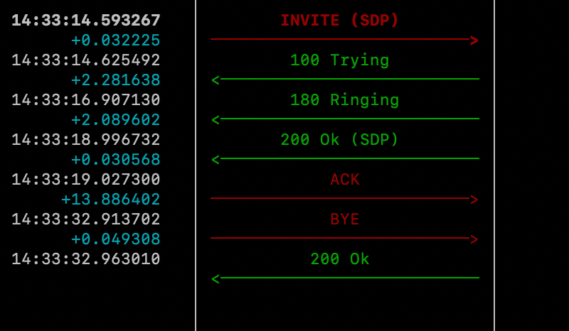
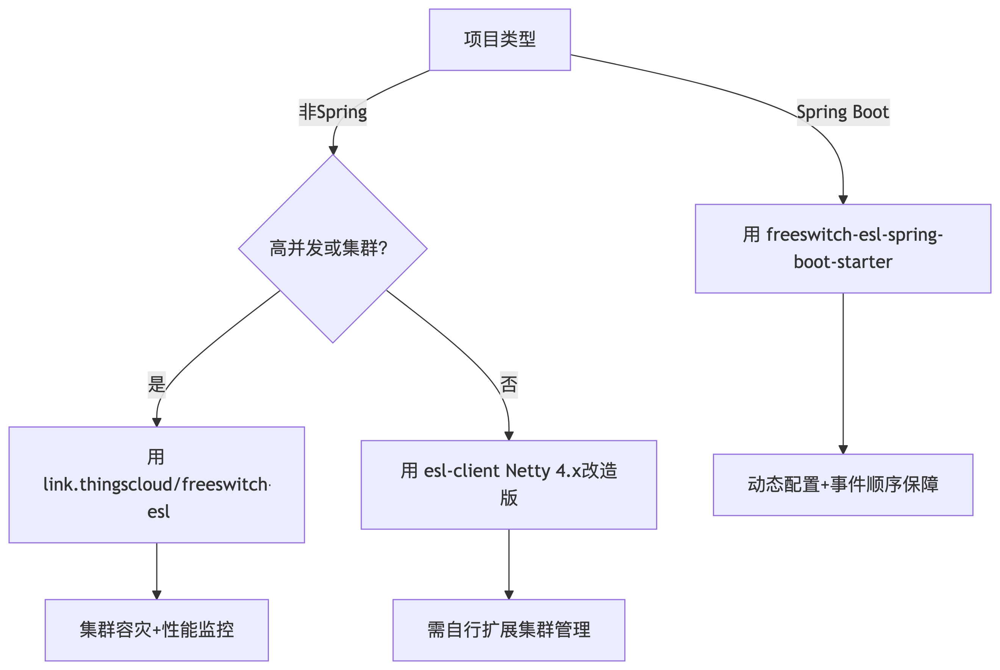

- [📡 一、`EslEvent` 对象能获取的信息类型](#-一eslevent-对象能获取的信息类型)
  - [1. **核心呼叫元数据**（最常用）](#1-核心呼叫元数据最常用)
  - [2. **通道状态信息**](#2-通道状态信息)
  - [3. **SIP摘要信息**（非原始信令）](#3-sip摘要信息非原始信令)
  - [4. **媒体信息**](#4-媒体信息)
- [🛠️ 二、对应用开发的实用价值](#️-二对应用开发的实用价值)
  - [1. 实时呼叫监控仪表盘](#1-实时呼叫监控仪表盘)
  - [2. 挂机原因分析（优化IVR）](#2-挂机原因分析优化ivr)
  - [3. 动态路由决策](#3-动态路由决策)
  - [4. 计费系统集成](#4-计费系统集成)
  - [5. 自定义业务逻辑触发](#5-自定义业务逻辑触发)
- [三、FreeSWITCH ESL客户端库](#三freeswitch-esl客户端库)
  - [**前提：** 在 freeswitch 中配置开启event\_socket](#前提-在-freeswitch-中配置开启event_socket)
  - [⚙️ **1. 核心库对比：`esl-client`（Netty 4.x改造版） vs `link.thingscloud/freeswitch-esl`**](#️-1-核心库对比esl-clientnetty-4x改造版-vs-linkthingscloudfreeswitch-esl)
    - [`esl-client`](#esl-client)
    - [`link.thingscloud/freeswitch-esl`](#linkthingscloudfreeswitch-esl)
  - [🌱 **2. Spring生态整合：`freeswitch-esl-spring-boot-starter`的核心优势**](#-2-spring生态整合freeswitch-esl-spring-boot-starter的核心优势)
  - [⚠️ **3. 旧版Netty 3.x的致命缺陷与规避方案**](#️-3-旧版netty-3x的致命缺陷与规避方案)
    - [💎 **终极选型决策树**](#-终极选型决策树)
  - [📊 **4. 性能与扩展性实测建议**](#-4-性能与扩展性实测建议)
  - [**总结：向前兼容与未来演进**](#总结向前兼容与未来演进)

其中：

- 实时控制：ESL 事件与命令（核心）。
- 媒体处理：音频流、传真文件（需专用模块）。
- 状态管理：通道变量、全局状态 API。
- 持久化数据：CDR 话单、数据库存储。
- 扩展集成：REST/XML-RPC/Kafka 适配第三方系统。

以下主要介绍核心的事件交互，接口话单交互在写话单的章节已经有所描述，其余数据库、队列为媒介的交互，在后续章节会详细介绍。

- [📡 一、`EslEvent` 对象能获取的信息类型](#-一eslevent-对象能获取的信息类型)
  - [1. **核心呼叫元数据**（最常用）](#1-核心呼叫元数据最常用)
  - [2. **通道状态信息**](#2-通道状态信息)
  - [3. **SIP摘要信息**（非原始信令）](#3-sip摘要信息非原始信令)
  - [4. **媒体信息**](#4-媒体信息)
- [🛠️ 二、对应用开发的实用价值](#️-二对应用开发的实用价值)
  - [1. 实时呼叫监控仪表盘](#1-实时呼叫监控仪表盘)
  - [2. 挂机原因分析（优化IVR）](#2-挂机原因分析优化ivr)
  - [3. 动态路由决策](#3-动态路由决策)
  - [4. 计费系统集成](#4-计费系统集成)
  - [5. 自定义业务逻辑触发](#5-自定义业务逻辑触发)
- [三、FreeSWITCH ESL客户端库](#三freeswitch-esl客户端库)
  - [**前提：** 在 freeswitch 中配置开启event\_socket](#前提-在-freeswitch-中配置开启event_socket)
  - [⚙️ **1. 核心库对比：`esl-client`（Netty 4.x改造版） vs `link.thingscloud/freeswitch-esl`**](#️-1-核心库对比esl-clientnetty-4x改造版-vs-linkthingscloudfreeswitch-esl)
    - [`esl-client`](#esl-client)
    - [`link.thingscloud/freeswitch-esl`](#linkthingscloudfreeswitch-esl)
  - [🌱 **2. Spring生态整合：`freeswitch-esl-spring-boot-starter`的核心优势**](#-2-spring生态整合freeswitch-esl-spring-boot-starter的核心优势)
  - [⚠️ **3. 旧版Netty 3.x的致命缺陷与规避方案**](#️-3-旧版netty-3x的致命缺陷与规避方案)
    - [💎 **终极选型决策树**](#-终极选型决策树)
  - [📊 **4. 性能与扩展性实测建议**](#-4-性能与扩展性实测建议)
  - [**总结：向前兼容与未来演进**](#总结向前兼容与未来演进)


### 📡 一、`EslEvent` 对象能获取的信息类型

- 传递内容：系统状态变更（如通话开始/结束）、通道变量、自定义消息（如 CUSTOM 事件）。
- 典型场景：实时监控通话状态、触发业务流程（如来电弹屏）。
- 协议/机制：ESL（Event Socket Library）的 plain/json/xml 格式

#### 1. **核心呼叫元数据**（最常用）
| 字段名                  | 示例值                         | 说明                     |
|-------------------------|--------------------------------|--------------------------|
| `Caller-Caller-ID-Name` | `"John Doe"`                   | 主叫名称                 |
| `Caller-Destination-Number` | `1000`                      | 被叫号码                 |
| `Caller-ANI`            | `13800138000`                 | 主叫号码(ANI)           |
| `Hangup-Cause`          | `NORMAL_CLEARING`             | 挂机原因代码             |
| `variable_billsec`      | `120`                         | 计费时长(秒)            |

#### 2. **通道状态信息**
```json
{
  "Channel-State": "CS_EXECUTE",  // 通道状态
  "Channel-Call-State": "ACTIVE", // 呼叫状态
  "Answer-State": "answered"      // 应答状态
}
```

#### 3. **SIP摘要信息**（非原始信令）
| 字段名               | 说明                          |
|----------------------|-------------------------------|
| `variable_sip_h_X-Header` | 自定义SIP头 (如 `X-Campaign-ID`) |
| `variable_sip_contact_user` | Contact头中的用户部分       |
| `variable_sip_via_proxy` | 经过的SIP代理地址           |

#### 4. **媒体信息**
```json
{
  "variable_rtp_use_codec_name": "PCMA",  // 使用编解码
  "variable_rtp_audio_in_media_port": "16384" // RTP端口
}
```

### 🛠️ 二、对应用开发的实用价值

通常情况下，中小型企业，有高性能的DB支撑，没有严格的上下游要求，仅是freeswitch xml配置所能实现的功能，就足以支持业务需求。但是当企业达到一定规模，从业务性能、定时化功能、业务监控等多维度出发，都需要与Java服务进行交互，实现更复杂的业务逻辑。

#### 1. 实时呼叫监控仪表盘
```java
// 监听CHANNEL_CREATE事件构建呼叫看板
event.getEventHeaders().forEach((k,v) -> {
  if(k.startsWith("Caller-")) {
    dashboard.updateCall(k, v); 
  }
});
```

#### 2. 挂机原因分析（优化IVR）
```java
if("CHANNEL_HANGUP".equals(eventName)){
  String cause = event.getHeader("Hangup-Cause");
  stats.logAbandonment(cause); // 统计用户放弃原因
}
```

#### 3. 动态路由决策
```java
// 根据主叫号码前缀路由
String ani = event.getHeader("Caller-ANI");
if(ani.startsWith("800")) {
  originateTollFreeCall(ani); 
}
```

#### 4. 计费系统集成
```java
// 通话结束时获取计费信息
int billsec = Integer.parseInt(event.getHeader("variable_billsec"));
billing.chargeCall(billsec);
```

#### 5. 自定义业务逻辑触发
```java
// 检测自定义SIP头触发营销动作
if(event.containsHeader("variable_sip_h_X-Promo-Code")){
  promo.activate(event.getHeader("variable_sip_h_X-Promo-Code"));
}
```

### 三、FreeSWITCH ESL客户端库

以下主要针对JAVA对接的方式，介绍几种可用的客户端库，能够不用自行根据netty实现，复用轮子，这几种方法使用起来都算简便，具体看各个项目情况进行选用

- esl-client的Netty 4.x改造版: https://github.com/esl-client/esl-client
- link.thingscloud/freeswitch-esl：https://github.com/zhouhailin/freeswitch-externals/tree/2.2.0/freeswitch-esl
- link.thingscloud/freeswitch-esl-spring-boot-starter：https://github.com/zhouhailin/freeswitch-externals/tree/2.2.0/freeswitch-esl-spring-boot-starter

#### **前提：** 在 freeswitch 中配置开启event_socket

- `modules.conf`中需要编译 `event_handlers/mod_event_socket`，引入后重新编译
- 配置 ` /usr/local/freeswitch/conf/autoload_configs/event_socket.conf.xml`

```xml
<configuration name="event_socket.conf" description="Socket Client">
  <settings>
    <param name="nat-map" value="false"/>
    <param name="listen-ip" value="0.0.0.0"/>
    <param name="listen-port" value="8021"/>
    <param name="password" value="ClueCon"/>
    <param name="apply-inbound-acl" value="lan"/>
    <!--<param name="stop-on-bind-error" value="true"/>-->
  </settings>
</configuration>                 
```

#### ⚙️ **1. 核心库对比：`esl-client`（Netty 4.x改造版） vs `link.thingscloud/freeswitch-esl`**
| **特性**               | **`esl-client`（Netty 4.x改造版）**                     | **`link.thingscloud/freeswitch-esl`**                 |
|------------------------|-------------------------------------------------------|------------------------------------------------------|
| **技术基础**           | 基于官方`org.freeswitch.esl.client`升级Netty 4.x         | 完全重写，原生Netty 4实现，深度优化线程模型          |
| **资源泄漏修复**       | ✅ 修复Netty 3.x的线程泄漏问题（需手动合并代码） | ✅ 原生规避Netty 3缺陷，无资源泄漏风险 |
| **集群支持**           | ❌ 仅支持单节点连接                                  | ✅ 动态管理多节点（`addServerOption`/`removeServerOption`） |
| **连接管理**           | 基础连接池，需自行封装                              | 内置智能重连、心跳保活、故障自动切换 |
| **维护状态**           | 社区非官方分支，更新不稳定                          | 活跃维护（2024年仍有更新，版本迭代至2.2.0）    |
| **性能监控**           | ❌ 无                                               | ✅ 支持事件处理耗时统计（`performanceCostTime`） |

> **关键结论**：  
> - **稳定性优先** → 选`link.thingscloud/freeswitch-esl`：企业级功能+长期维护。  
> - **兼容旧项目** → 可尝试`esl-client`改造版，但需自行解决集群等扩展需求。

##### `esl-client`

```java
public class EslInboundClientExample {

    /**
     * <p>main.</p>
     *
     * @param args an array of {@link java.lang.String} objects.
     */
    public static void main(String[] args) {
        InboundClientOption option = new InboundClientOption();

        option.defaultPassword("ClueCon")
                .addServerOption(new ServerOption("127.0.0.1", 8021));
        option.addEvents("all");

        option.addListener(new IEslEventListener() {
            @Override
            public void eventReceived(String addr, EslEvent event) {
                System.out.println(addr);
                System.out.println(event);
            }

            @Override
            public void backgroundJobResultReceived(String addr, EslEvent event) {
                System.out.println(addr);
                System.out.println(event);
            }
        });

        option.serverConnectionListener(new ServerConnectionListener() {
            @Override
            public void onOpened(ServerOption serverOption) {
                System.out.println("---onOpened--");
            }

            @Override
            public void onClosed(ServerOption serverOption) {
                System.out.println("---onClosed--");
            }
        });

        InboundClient inboundClient = InboundClient.newInstance(option);

        inboundClient.start();


        System.out.println(option.serverAddrOption().first());
        System.out.println(option.serverAddrOption().last());
        System.out.println(option.serverAddrOption().random());


    }

}
```

##### `link.thingscloud/freeswitch-esl`

```java
public class ClientExample {
    private static final Logger L = LoggerFactory.getLogger(ClientExample.class);

    public static void main(String[] args) {
        try {
            if (args.length < 1) {
                System.out.println("Usage: java ClientExample PASSWORD");
                return;
            }

            String password = args[0];

            Client client = new Client();

            client.addEventListener((ctx, event) ->{
                L.info("Received event:{} ====================",event.getEventName());
            });

            client.connect(new InetSocketAddress("127.0.0.1", 8021), password, 10);
            client.setEventSubscriptions(EventFormat.PLAIN, "all");

        } catch (Throwable t) {
            Throwables.propagate(t);
        }
    }
}
```

#### 🌱 **2. Spring生态整合：`freeswitch-esl-spring-boot-starter`的核心优势**

**开箱即用配置**
```yaml
# application.yml
link:
  thingscloud:
    freeswitch:
      esl:
        inbound:
          defaultPassword: ClueCon
          performance: false
          performanceCostTime: 200
          servers:
            - host: fs1.example.com
              port: 8021
              password: ClueCon
            - host: 127.0.0.1
              port: 8021              
          events: CHANNEL_CREATE, CHANNEL_DESTROY  # 按需订阅事件，all是订阅所有
```

接收并处理某个event：

```java
@Slf4j
@Component
@EslEventName(EventNames.HEARTBEAT)
public class HeartbeatEslEventHandler implements EslEventHandler {
    /**
     * {@inheritDoc}
     */
    @Override
    public void handle(String addr, EslEvent event) {
        log.info("HeartbeatEslEventHandler handle addr[{}] EslEvent[{}].", addr, event);
    }
}
```
一个简单的对话：


捕获 `all` 的 ESL EVENT 样例:

```log
2025-08-01 14:40:00.123  INFO 92506 --- [licExecutor-1-8] l.t.f.e.s.b.s.e.HeartbeatEslEventHandler : HeartbeatEslEventHandler handle addr[127.0.0.1:8021] EslEvent[EslEvent: name=[HEARTBEAT] headers=2, eventHeaders=28, eventBody=0 lines.].
2025-08-01 15:24:53.478  WARN 58180 --- [licExecutor-1-4] l.t.f.e.s.b.s.h.DefaultEslEventHandler   : Default esl event handler handle addr[127.0.0.1:8021], event[
#
## message header : 
CONTENT_TYPE=text/event-plain
CONTENT_LENGTH=1781
## event header : 
=
Core-UUID=f2e59381-6fe5-4603-b5f2-063f97340f50
Event-Calling-Line-Number=2408
FreeSWITCH-Hostname=opensips
Caller-Unique-ID=7a49e5b5-db65-4ed0-bc7b-ebe283cdbc1a
Caller-Channel-Progress-Media-Time=0
FreeSWITCH-IPv6=::1
Caller-Caller-ID-Number=0000000000
FreeSWITCH-IPv4=127.0.0.1
Caller-Destination-Number=1000
Caller-Channel-Answered-Time=0
Channel-State=CS_CONSUME_MEDIA
Channel-HIT-Dialplan=false
Caller-Channel-Last-Hold=0
Caller-Callee-ID-Name=Outbound Call
Event-Date-Timestamp=1754033093652047
Channel-State-Number=7
Caller-Callee-ID-Number=1000
Caller-Channel-Name=sofia/internal/1000@127.0.0.1:5061
Presence-Call-Direction=outbound
Unique-ID=7a49e5b5-db65-4ed0-bc7b-ebe283cdbc1a
Caller-Direction=outbound
Event-Name=CHANNEL_STATE
Caller-Profile-Created-Time=1754033093652047
Channel-Call-State=DOWN
Caller-Screen-Bit=true
Caller-Logical-Direction=outbound
Event-Calling-File=switch_channel.c
Caller-Channel-Hold-Accum=0
Call-Direction=outbound
FreeSWITCH-Switchname=opensips
Caller-Channel-Progress-Time=0
Caller-Privacy-Hide-Name=false
Caller-Privacy-Hide-Number=false
Event-Date-Local=2025-08-01 15:24:53
Caller-Channel-Bridged-Time=0
Caller-Source=src/switch_ivr_originate.c
Event-Date-GMT=Fri, 01 Aug 2025 07:24:53 GMT
Answer-State=ringing
Caller-ANI=0000000000
Caller-Channel-Hangup-Time=0
Caller-Channel-Resurrect-Time=0
Caller-Orig-Caller-ID-Number=0000000000
Event-Calling-Function=switch_channel_perform_set_running_state
Caller-Channel-Transfer-Time=0
Caller-Profile-Index=1
Caller-Channel-Created-Time=1754033093652047
Event-Sequence=1150
Channel-Name=sofia/internal/1000@127.0.0.1:5061
Channel-Call-UUID=7a49e5b5-db65-4ed0-bc7b-ebe283cdbc1a
Caller-Context=default
## event body lines : 
#
]
2025-08-01 15:24:56.849  WARN 58180 --- [licExecutor-1-2] l.t.f.e.s.b.s.h.DefaultEslEventHandler   : Default esl event handler handle addr[127.0.0.1:8021], event[
#
## message header : 
CONTENT_TYPE=text/event-plain
CONTENT_LENGTH=1896
## event header : 
=
Core-UUID=f2e59381-6fe5-4603-b5f2-063f97340f50
Event-Calling-Line-Number=301
FreeSWITCH-Hostname=opensips
Caller-Unique-ID=7a49e5b5-db65-4ed0-bc7b-ebe283cdbc1a
Caller-Channel-Progress-Media-Time=0
FreeSWITCH-IPv6=::1
Caller-Caller-ID-Number=0000000000
FreeSWITCH-IPv4=127.0.0.1
Caller-Destination-Number=1000
Original-Channel-Call-State=DOWN
Caller-Channel-Answered-Time=0
Channel-State=CS_CONSUME_MEDIA
Channel-HIT-Dialplan=false
Caller-Channel-Last-Hold=0
Caller-Callee-ID-Name=Outbound Call
Event-Date-Timestamp=1754033097012096
Channel-State-Number=7
Caller-Callee-ID-Number=1000
Caller-Channel-Name=sofia/internal/1000@127.0.0.1:5061
Presence-Call-Direction=outbound
Unique-ID=7a49e5b5-db65-4ed0-bc7b-ebe283cdbc1a
Caller-Direction=outbound
Event-Name=CHANNEL_CALLSTATE
Caller-Profile-Created-Time=1754033093652047
Channel-Call-State=RINGING
Caller-Screen-Bit=true
Caller-Logical-Direction=outbound
Event-Calling-File=switch_channel.c
Caller-Channel-Hold-Accum=0
Call-Direction=outbound
FreeSWITCH-Switchname=opensips
Caller-Channel-Progress-Time=1754033097012096
Caller-Privacy-Hide-Name=false
Caller-Privacy-Hide-Number=false
Event-Date-Local=2025-08-01 15:24:57
Caller-Channel-Bridged-Time=0
Caller-Source=src/switch_ivr_originate.c
Event-Date-GMT=Fri, 01 Aug 2025 07:24:57 GMT
Answer-State=ringing
Caller-ANI=0000000000
Caller-Channel-Hangup-Time=0
Caller-Channel-Resurrect-Time=0
Caller-Network-Addr=127.0.0.1
Channel-Call-State-Number=2
Caller-Orig-Caller-ID-Number=0000000000
Event-Calling-Function=switch_channel_perform_set_callstate
Caller-Channel-Transfer-Time=0
Caller-Profile-Index=1
Caller-Channel-Created-Time=1754033093652047
Event-Sequence=1154
Channel-Name=sofia/internal/1000@127.0.0.1:5061
Channel-Call-UUID=7a49e5b5-db65-4ed0-bc7b-ebe283cdbc1a
Caller-Context=default
## event body lines : 
#
]
```

**企业级特性**
- **动态节点管理**：运行时增减FreeSWITCH节点（如集群扩容）。
- **事件顺序保障**：单线程池处理事件，避免并发乱序（关键于呼叫流程如`振铃→接听→挂断`）。
- **深度监控**：集成Spring Actuator，暴露连接状态/事件延迟指标。

**对比原生整合**
| **场景**               | **手动集成`esl-client`**                     | **使用Starter**                                  |
|------------------------|---------------------------------------------|------------------------------------------------|
| **多节点配置**         | 需编码实现动态注册                          | YAML声明式配置，自动注入`InboundClient` Bean     |
| **事件监听**           | 需实现`IEslEventListener`并管理线程         | `@EslEventListener`注解+方法自动路由 |
| **资源释放**           | 需显式调用`close()`并捕获异常               | 生命周期托管，Spring Context关闭时自动清理        |

> **推荐场景**：  
> **所有Spring Boot项目** → 必选`freeswitch-esl-spring-boot-starter`，减少70%样板代码。

---

#### ⚠️ **3. 旧版Netty 3.x的致命缺陷与规避方案**

**典型问题（`org.freeswitch.esl.client:0.9.2`）**
- **线程泄漏**：未释放Netty的`ByteBuf`和`EventLoop`线程，导致OOM。
- **无界队列风险**：`LinkedBlockingQueue`默认容量`Integer.MAX_VALUE`，高并发下内存飙升。

**临时解决方案（非推荐）**
```java
// 显式释放Netty资源（旧版补救）
channel.close().sync();  // 补充官方未实现的清理
executor.shutdownNow();  // 防止单线程池堆积
```

> **强烈建议**：  
> 生产环境直接迁移至`link.thingscloud`系列库，彻底规避Netty 3隐患。


##### 💎 **终极选型决策树**



#### 📊 **4. 性能与扩展性实测建议**
1. **压力测试**：  
   - 模拟1k+并发连接，观察`EventLoop`线程数（Netty 4应稳定在`核数*2`）。
   - 监控堆外内存（`DirectBuffer`）是否及时释放。
2. **灾备验证**：  
   - 主动宕机FS节点，检查客户端重连日志（预期：10秒内切换备份节点）。
3. **事件顺序性**：  
   - 注入乱序事件（如先发送`HANGUP`再`ANSWER`），验证是否被纠正。

---

#### **总结：向前兼容与未来演进**
- **存量系统迁移**：  
  替换`org.freeswitch.esl.client`为`link.thingscloud/freeswitch-esl`，彻底解决资源泄漏。  
- **新建项目标准**：  
  - Spring Boot架构 → `freeswitch-esl-spring-boot-starter`  
  - 高可用集群 → `freeswitch-esl` + 动态节点管理  
- **警惕“半改造”方案**：  
  社区分支（如esl-client Netty 4.x版）缺乏企业级验证，慎用于生产。