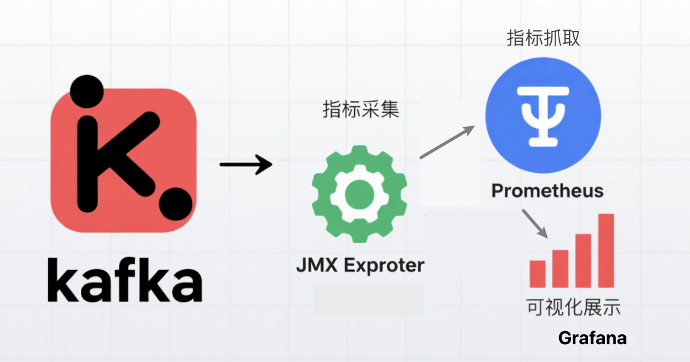

- [为什么需要Kafka监控](#为什么需要kafka监控)
- [监控架构概述](#监控架构概述)
- [步骤一：部署JMX Exporter](#步骤一部署jmx-exporter)
  - [1.1 下载JMX Agent](#11-下载jmx-agent)
  - [1.2 创建指标暴露配置](#12-创建指标暴露配置)
- [步骤二：配置Kafka集成JMX](#步骤二配置kafka集成jmx)
  - [2.1 启动参数配置](#21-启动参数配置)
  - [2.2 验证指标暴露](#22-验证指标暴露)
- [步骤三：配置Prometheus采集](#步骤三配置prometheus采集)
  - [3.1 修改Prometheus配置](#31-修改prometheus配置)
  - [3.2 验证数据采集](#32-验证数据采集)
- [步骤四：Grafana可视化配置](#步骤四grafana可视化配置)
  - [4.1 添加Prometheus数据源](#41-添加prometheus数据源)
  - [4.2 导入Kafka监控面板](#42-导入kafka监控面板)
- [关键监控指标解析](#关键监控指标解析)
- [常见问题与解决方案](#常见问题与解决方案)
  - [Q1: 指标采集不完整？](#q1-指标采集不完整)
  - [Q2: 监控数据延迟？](#q2-监控数据延迟)
  - [Q3: Grafana面板无数据？](#q3-grafana面板无数据)
- [监控体系扩展建议](#监控体系扩展建议)
- [总结](#总结)

## 为什么需要Kafka监控

Kafka作为分布式流处理平台，在高并发场景下的稳定性至关重要。一个完善的监控体系能够帮助我们：
- 实时掌握集群健康状态
- 提前预警潜在性能瓶颈
- 快速定位故障根因
- 优化资源配置与成本

本文将详细介绍如何通过Prometheus+JMX Exporter+Grafana构建企业级Kafka监控方案，实现从指标采集、存储到可视化告警的全流程落地。

## 监控架构概述



**核心组件说明**：
- **JMX Exporter**：暴露Kafka内部JMX指标
- **Prometheus**：时序数据存储与指标采集
- **Grafana**：可视化仪表盘与告警配置

## 步骤一：部署JMX Exporter

### 1.1 下载JMX Agent

```bash
wget https://repo1.maven.org/maven2/io/prometheus/jmx/jmx_prometheus_javaagent/0.20.0/jmx_prometheus_javaagent-0.20.0.jar
```

### 1.2 创建指标暴露配置

创建JMX Exporter配置文件（kafka-jmx-config.yaml），指定需要采集的指标：

```yaml
# 基础配置：暴露所有JMX指标（生产环境建议按需过滤）
lowercaseOutputName: true
rules:
  - pattern: ".*"
```

> **最佳实践**：生产环境应根据业务需求筛选关键指标，避免监控数据过载。可参考[官方推荐监控指标](https://kafka.apache.org/documentation/#monitoring)进行配置。

## 步骤二：配置Kafka集成JMX

### 2.1 启动参数配置

修改Kafka启动脚本，添加JMX相关参数：

```bash
KAFKA_JMX_OPTS="-javaagent:/data/software/kafka-agent/jmx_prometheus_javaagent-0.20.0.jar=7071:/data/software/kafka-agent/kafka-jmx-config.yaml  \
-Dcom.sun.management.jmxremote=true  \
-Dcom.sun.management.jmxremote.port=9999  \
-Dcom.sun.management.jmxremote.rmi.port=9999 \
-Djava.rmi.server.hostname=127.0.0.1 \
-Dcom.sun.management.jmxremote.authenticate=false \
-Dcom.sun.management.jmxremote.ssl=false"
./bin/kafka-server-start.sh config/kraft/server.properties
```

**参数说明**：
- `7071`：JMX Exporter暴露指标的端口（供Prometheus抓取）
- `9999`：原始JMX端口（用于直接JMX连接，可选）

### 2.2 验证指标暴露

通过curl命令验证指标是否正常暴露：

```bash
curl http://127.0.0.1:7071/metrics
```

成功响应示例：

```bash
# HELP kafka_server_replica_fetcher_metrics_connection_creation_total The total number of new connections established
kafka_server_replica_fetcher_metrics_connection_creation_total{broker_id="1",fetcher_id="0",} 1.0
# HELP kafka_server_replica_fetcher_metrics_incoming_byte_total The total number of bytes read off all sockets
kafka_server_replica_fetcher_metrics_incoming_byte_total{broker_id="1",fetcher_id="0",} 1784.0
...
```

## 步骤三：配置Prometheus采集

### 3.1 修改Prometheus配置

编辑prometheus.yml，添加Kafka监控任务：

```yaml
scrape_configs:
  - job_name: 'kafka'
    static_configs:
      - targets: ['127.0.0.1:7071']  # JMX Exporter暴露的端口
    scrape_interval: 10s  # 采集频率，根据业务需求调整
    scrape_timeout: 5s
```

### 3.2 验证数据采集

重启Prometheus后，访问http://prometheus-ip:9090，查询以下指标验证采集状态：
- `kafka_broker_topic_messages_in_per_sec`：消息流入速率
- `kafka_server_replica_manager_under_replicated_partitions`：副本未同步数量
- `kafka_controller_kafka_controller_stats_active_controller_count`：控制器状态

## 步骤四：Grafana可视化配置

### 4.1 添加Prometheus数据源

1. 登录Grafana控制台，进入Configuration > Data Sources
2. 点击Add data source，选择Prometheus
3. 配置Prometheus地址，保存并测试连接

### 4.2 导入Kafka监控面板

推荐使用社区成熟的Kafka监控面板：
- **面板ID**: 721
- **面板名称**: Kafka Exporter
- **安装命令**: `grafana-cli dashboards import 721`

> **自定义面板**：根据业务需求调整面板，重点关注：
> - 消息生产/消费延迟
> - 分区副本同步状态
> -  broker资源使用率
> - 消费者组滞后量

## 关键监控指标解析

| 指标类别 | 核心指标 | 指标含义 | 告警阈值建议 |
|---------|---------|---------|------------|
| 吞吐量 | kafka_broker_topic_messages_in_per_sec | 每秒消息流入量 | 根据业务峰值定义 |
| 存储 | kafka_log_log_size | 分区日志大小 | >80%磁盘容量 |
| 副本 | kafka_server_replica_manager_under_replicated_partitions | 未同步副本数 | >0 |
| 消费者 | kafka_consumer_group_lag | 消费滞后量 | >5000条 |
| 连接 | kafka_network_requestmetrics_requests_total | 请求总数 | 异常波动>30% |

## 常见问题与解决方案

### Q1: 指标采集不完整？
A1: 检查JMX Exporter版本兼容性，建议使用与Kafka版本匹配的exporter版本。

### Q2: 监控数据延迟？
A2: 调整Prometheus的scrape_interval参数，平衡监控实时性与资源消耗。

### Q3: Grafana面板无数据？
A3: 检查Prometheus数据源配置及网络连通性，通过Prometheus UI验证指标是否存在。

## 监控体系扩展建议

1. **告警配置**：基于关键指标设置多级告警（P0-P2），通过Alertmanager集成邮件、钉钉等通知渠道
2. **日志集成**：结合ELK/EFK栈收集Kafka日志，实现日志与指标的关联分析
3. **集群监控**：使用Node Exporter监控主机资源，全面掌握系统运行状态
4. **自动化运维**：集成Ansible/Puppet实现监控配置的自动化部署与管理

## 总结

通过Prometheus+JMX Exporter+Grafana的组合，我们构建了一套完整的Kafka监控体系，实现了从指标采集、存储到可视化的全流程覆盖。该方案不仅能帮助运维人员实时掌握集群状态，还能为性能优化和容量规划提供数据支持。

随着业务发展，建议持续优化监控策略，关注社区最新实践，构建更智能、更全面的可观测性平台。

> **参考资料**：
> - [Kafka官方监控文档](https://kafka.apache.org/documentation/#monitoring)
> - [Prometheus JMX Exporter](https://github.com/prometheus/jmx_exporter)
> - [Grafana Kafka Dashboards](https://grafana.com/grafana/dashboards/?search=kafka)

