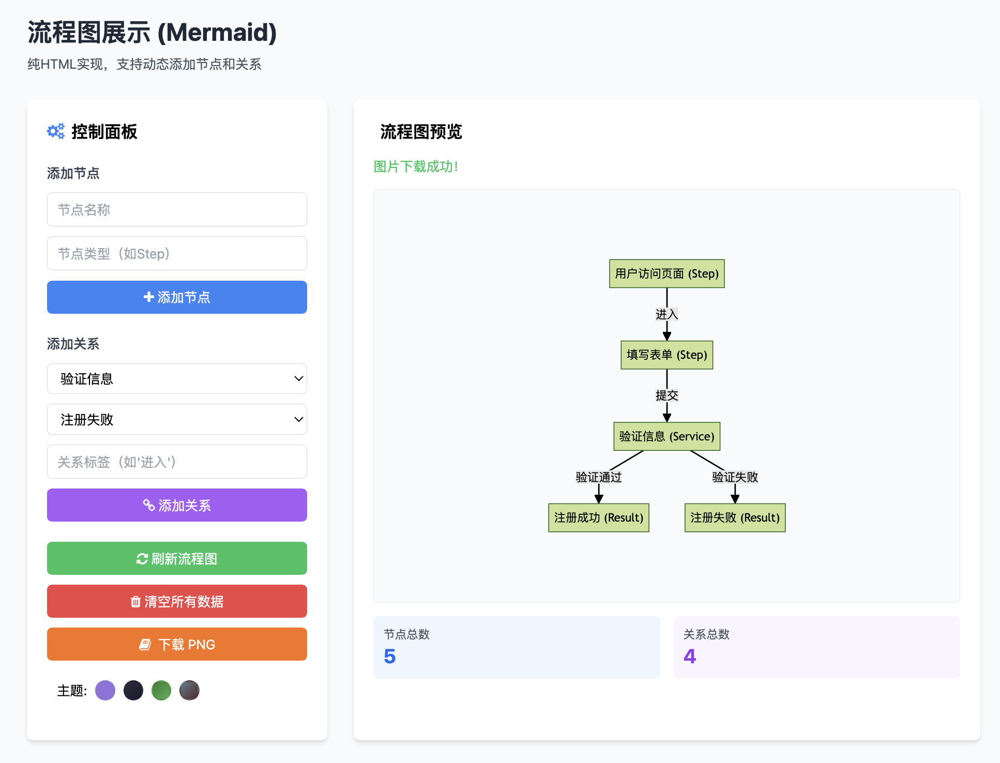

- [什么是Mermaid?](#什么是mermaid)
- [系统架构设计](#系统架构设计)
  - [三层架构 overview](#三层架构-overview)
  - [架构交互流程](#架构交互流程)
- [核心组件详解](#核心组件详解)
  - [1. Spring Boot后端](#1-spring-boot后端)
  - [2. Node.js中间层](#2-nodejs中间层)
  - [3. 前端界面](#3-前端界面)
- [功能实现](#功能实现)
  - [1. 节点和关系管理](#1-节点和关系管理)
  - [2. 流程图渲染](#2-流程图渲染)
  - [3. 主题切换](#3-主题切换)
  - [4. 导出功能](#4-导出功能)
- [使用指南](#使用指南)
  - [启动步骤](#启动步骤)
  - [页面操作](#页面操作)
- [总结与展望](#总结与展望)

### 什么是Mermaid?

Mermaid流程图可视化系统是一个支持动态创建、管理和展示流程图的Web应用。Mermaid 是一个基于 JavaScript 的图表和制图工具，使用 Markdown 风格的文本定义和渲染器来创建和修改复杂的图表。Mermaid 的主要目的是帮助文档跟上开发进度。

[官方语法链接](https://docs.min2k.com/zh/mermaid/intro/syntax-reference.html)

### 系统架构设计

#### 三层架构 overview

该系统采用现代化的三层架构设计，结合了Spring Boot的数据处理能力、Node.js的轻量级中间层优势以及Mermaid库的流程图绘制功能，实现了一个功能完整、交互友好的流程图可视化解决方案。

```bash
├── html-frontend
│   └── index.html
├── img
│   ├── mermaid-diagram.png
│   └── mermaid流程图测试.png
├── nodejs-middleware
│   ├── package.json
│   └── server.js
├── README.md
└── springboot-backend
    ├── pom.xml
    ├── src
    └── target
```


系统采用经典的三层架构设计，各层职责明确、松耦合：

1. **前端展示层**：基于纯HTML、JavaScript和Tailwind CSS构建，负责用户交互和流程图展示
2. **中间层**：基于Node.js和Express框架实现，处理前端请求并转发给后端
3. **后端服务层**：基于Spring Boot构建，负责数据持久化和业务逻辑处理

#### 架构交互流程

```
用户操作 → 前端界面 → Node.js中间层 → Spring Boot后端 → 数据库
```



### 核心组件详解

#### 1. Spring Boot后端

后端采用Spring Boot 2.7.0构建，主要负责数据的持久化和业务逻辑处理：

- **数据访问层**：使用Spring Data JPA实现对实体的CRUD操作
- **Web层**：通过Spring Web和WebFlux提供RESTful API
- **数据库**：使用H2内存数据库存储图形数据，便于快速开发和演示
- **技术栈**：Java 11, Spring Boot, Spring Data JPA, Spring WebFlux, H2 Database

根据`springboot-backend/pom.xml`文件，后端依赖配置清晰，包含了必要的Web、数据访问和测试组件。

书写请求接口：
```java
@RestController
@RequestMapping("/api/graph")
@CrossOrigin(origins = "http://localhost:3000") // 允许跨域访问
public class GraphController {

    @Autowired
    private NodeRepository nodeRepository;

    @Autowired
    private RelationshipRepository relationshipRepository;

    // 节点相关接口
    @GetMapping("/nodes")
    public List<Node> getAllNodes() {
        return nodeRepository.findAll();
    }

    @PostMapping("/nodes")
    public Node createNode(@RequestBody Node node) {
        return nodeRepository.save(node);
    }

    // 关系相关接口
    @GetMapping("/relationships")
    public List<Relationship> getAllRelationships() {
        return relationshipRepository.findAll();
    }

    @PostMapping("/relationships")
    public Relationship createRelationship(@RequestBody Relationship relationship) {
        return relationshipRepository.save(relationship);
    }

    // 获取完整图形数据
    @GetMapping
    public ResponseEntity<Map<String, Object>> getFullGraph() {
        Map<String, Object> graphData = new HashMap<>();
        graphData.put("nodes", nodeRepository.findAll());
        graphData.put("relationships", relationshipRepository.findAll());
        return new ResponseEntity<>(graphData, HttpStatus.OK);
    }
}
```

#### 2. Node.js中间层

中间层基于Node.js和Express框架实现，主要职责是转发前端请求到后端，并处理跨域问题：

- **服务器**：使用Express创建轻量级Web服务器，监听3000端口
- **API代理**：通过Axios转发请求到Spring Boot后端（默认地址：http://localhost:8080/api/graph）
- **中间件**：使用CORS中间件处理跨域请求，使用express.json()解析JSON请求体
- **技术栈**：Node.js, Express, Axios, CORS

从`/nodejs-middleware/server.js`可以看出，中间层提供了三个主要API端点：
- GET /api/graph：获取完整图形数据
- POST /api/nodes：创建新节点
- POST /api/relationships：创建新关系

书写中间层请求：

```java
const express = require('express');
const axios = require('axios');
const cors = require('cors');

const app = express();
const PORT = 3000;
const SPRING_BOOT_API_URL = 'http://localhost:8080/api/graph';

// 中间件配置
app.use(cors());
app.use(express.json());

// 获取完整图形数据
app.get('/api/graph', async (req, res) => {
    try {
        const response = await axios.get(SPRING_BOOT_API_URL);
        res.json(response.data);
    } catch (error) {
        console.error('获取图形数据失败:', error);
        res.status(500).json({ error: '获取图形数据失败' });
    }
});

// 创建新节点
app.post('/api/nodes', async (req, res) => {
    try {
        const response = await axios.post(`${SPRING_BOOT_API_URL}/nodes`, req.body);
        res.json(response.data);
    } catch (error) {
        console.error('创建节点失败:', error);
        res.status(500).json({ error: '创建节点失败' });
    }
});

// 创建新关系
app.post('/api/relationships', async (req, res) => {
    try {
        const response = await axios.post(`${SPRING_BOOT_API_URL}/relationships`, req.body);
        res.json(response.data);
    } catch (error) {
        console.error('创建关系失败:', error);
        res.status(500).json({ error: '创建关系失败' });
    }
});

// 启动服务器
app.listen(PORT, () => {
    console.log(`Node.js中间层服务器运行在 http://localhost:${PORT}`);
});
```

#### 3. 前端界面

前端基于纯HTML实现，结合了多种现代化前端技术：

- **UI框架**：使用Tailwind CSS实现响应式布局和美观的UI组件
- **图标库**：使用Font Awesome提供直观的图标
- **流程图绘制**：使用Mermaid 10.9.1库绘制流程图
- **导出功能**：使用html2canvas和FileSaver.js实现流程图PNG导出
- **主题切换**：支持默认、深色、森林和中性四种主题

从`html-frontend/index.html`可以看出，前端实现了完整的用户交互界面，包括节点和关系的添加、流程图刷新、数据清空、主题切换和导出功能。

前端页面主要是对流程图节点和关系的新增，以及流程图的展示

### 功能实现

#### 1. 节点和关系管理

系统支持节点和关系的创建和管理：

- **节点管理**：支持添加节点，设置节点名称和类型
- **关系管理**：支持在两个节点之间添加带有标签的关系
- **数据同步**：所有操作实时同步到后端存储
- **统计展示**：实时显示节点和关系的数量统计

#### 2. 流程图渲染

使用Mermaid库实现流程图的动态渲染：

- **自动布局**：Mermaid自动计算节点位置，确保流程图美观
- **可定制样式**：支持通过主题切换改变流程图的整体风格
- **响应式设计**：流程图会根据容器大小自动调整

#### 3. 主题切换

系统支持四种不同的主题风格：

- **默认主题**：基于紫色系的默认风格
- **深色主题**：深色背景，适合长时间查看
- **森林主题**：绿色系主题，清新自然
- **中性主题**：基于灰色系的简约风格

#### 4. 导出功能

支持将流程图导出为PNG图片：

- **高质量渲染**：使用html2canvas确保导出图片质量
- **便捷保存**：通过FileSaver.js直接保存到本地

### 使用指南

#### 启动步骤

1. **启动Spring Boot后端**
   ```bash
   cd springboot-backend
   mvn spring-boot:run
   ```
   服务将运行在 `http://localhost:8080`

2. **启动Node.js中间层**
   ```bash
   cd nodejs-middleware
   npm install
   npm start
   ```
   服务将运行在 `http://localhost:3000`

3. **启动前端页面**
   ```bash
   cd html-frontend
   python -m http.server 8001
   ```
   访问 `http://localhost:8001` 即可使用系统

#### 页面操作

1. **添加节点**：填写节点名称和类型，点击"添加节点"按钮
2. **添加关系**：选择源节点和目标节点，填写关系标签，点击"添加关系"按钮
3. **刷新流程图**：点击"刷新流程图"按钮更新流程图显示
4. **切换主题**：点击主题选择器中的不同主题按钮
5. **下载流程图**：点击"下载PNG"按钮将流程图保存为图片

### 总结与展望

本项目通过三层架构的设计，充分发挥了各层技术的优势：Spring Boot提供了强大的数据处理能力，Node.js中间层实现了轻量级的请求转发，前端则通过Mermaid库实现了直观的流程图可视化。系统功能完整，交互友好，适合用于流程图的快速创建和展示。

未来可以考虑以下改进方向：

1. **数据持久化**：替换H2内存数据库为MySQL或PostgreSQL等持久化数据库
2. **用户认证**：添加用户认证和授权功能
3. **流程图模板**：提供常用流程图模板，方便用户快速创建
4. **实时协作**：添加多人实时协作编辑功能
5. **更多导出格式**：支持导出为PDF、SVG等更多格式
        