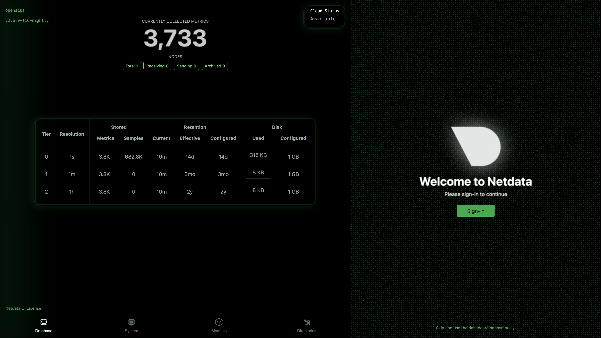
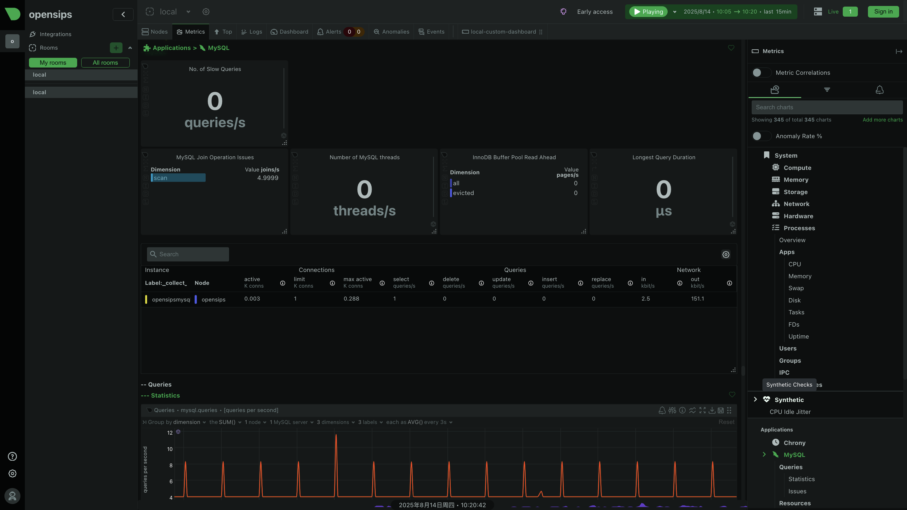
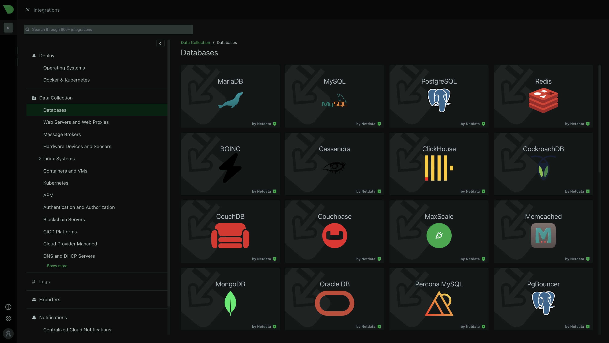

- [Netdata 是什么](#netdata-是什么)
- [和 **Prometheus + Grafana** 是组合式监控方案 有何区别](#和-prometheus--grafana-是组合式监控方案-有何区别)
  - [📊 **一、架构与核心功能对比**](#-一架构与核心功能对比)
  - [⚖️ **二、优势与劣势深度分析**](#️-二优势与劣势深度分析)
    - [**Netdata 核心优势**](#netdata-核心优势)
    - [**Netdata 主要局限**](#netdata-主要局限)
    - [**Prometheus + Grafana 核心优势**](#prometheus--grafana-核心优势)
    - [**Prometheus + Grafana 主要局限**](#prometheus--grafana-主要局限)
  - [🎯 **三、适用场景推荐**](#-三适用场景推荐)
- [安装体验](#安装体验)

## Netdata 是什么

Netdata 是一个开源的实时基础设施监控平台。监控、检测整个基础架构并采取行动。

核心优势：

- 即时洞察 – 使用 Netdata，您可以访问每秒的指标和可视化。
- 零配置 – 无需复杂的设置即可立即部署。
- ML 支持的 – 您可以检测异常、预测问题并自动执行分析。
- 高效 – 您可以以最少的资源使用量和最大的可扩展性进行监控。
- 安全和分布式 – 您可以将数据保存在本地，无需集中收集。

使用 Netdata，您可以获得实时的每秒更新。洞察一目了然，没有复杂性。

根据阿姆斯特丹大学的研究，**Netdata 是监控基于 Docker 的系统的最节能工具**。该研究还表明，与其他监控解决方案相比，Netdata 在 CPU 使用率、RAM 使用率和执行时间方面表现出色。

## 和 **Prometheus + Grafana** 是组合式监控方案 有何区别

### 📊 **一、架构与核心功能对比**
| **维度**         | **Netdata**                                | **Prometheus + Grafana**                     |
|------------------|--------------------------------------------|---------------------------------------------|
| **架构**         | 一体化Agent（数据采集+存储+UI）            | 分层架构（Prometheus 采集/存储 + Grafana 可视化） |
| **数据采集**     | 自动发现指标，支持 800+ 集成  | 需部署 Exporter 暴露指标，Prometheus 主动拉取  |
| **数据存储**     | 短期内存存储（默认几小时）    | 长期时序存储（Prometheus TSDB + 可选远程存储） |
| **实时性**       | **毫秒级更新**，1秒延迟可视化  | 通常15s~1分钟采集间隔，依赖配置  |
| **资源消耗**     | 极低（CPU≈2%，内存<100MB）    | 中等（Prometheus 需处理写入/压缩，Grafana 渲染开销） |

---

### ⚖️ **二、优势与劣势深度分析**
#### **Netdata 核心优势**
1. **零配置快速部署**  
   - 一键安装脚本即用，自动发现监控目标（系统/容器/应用）。
   - 开箱实时仪表盘，无需手动配置图表 。

2. **超高分辨率监控**  
   - 每秒采集数据，支持毫秒级异常定位（如网络抖动、CPU毛刺）。

3. **资源效率极致**  
   - C语言核心，实测比 Prometheus 节省 35% CPU 和 98% 磁盘 I/O 。

4. **内置AI异常检测**  
   - 自动标记异常点，减少阈值规则配置 。

#### **Netdata 主要局限**
1. **历史数据分析弱**  
   - 默认无长期存储，需集成 Prometheus 或云平台扩展 。

2. **告警功能较基础**  
   - 仅支持简单阈值告警，缺乏 Alertmanager 的分组/抑制/静默等高级能力 。

3. **分布式管理复杂**  
   - 多节点需手动聚合数据，无原生集群视图 。

---

#### **Prometheus + Grafana 核心优势**
1. **强大的数据生态**  
   - 支持 150+ 官方/社区 Exporter（数据库/硬件/K8s等）。
   - 可与日志链路追踪（如Loki）无缝集成 。

2. **灵活的历史查询**  
   - PromQL 支持多维度聚合、预测函数（如`predict_linear`）。

3. **企业级告警治理**  
   - Alertmanager 支持路由、去重、静默策略，适配复杂运维场景 。

4. **可视化高度自由**  
   - Grafana 提供 100+ 面板插件（热力图、甘特图等），支持自定义仪表盘 。

#### **Prometheus + Grafana 主要局限**
1. **部署配置复杂**  
   - 需独立部署 Exporter、Prometheus、Alertmanager、Grafana 四大组件 。

2. **实时性妥协**  
   - 默认抓取间隔>15s，短时故障易遗漏 。

3. **存储扩展成本高**  
   - 长期数据需对接 Thanos 或 M3DB，运维复杂度陡增 。

---

### 🎯 **三、适用场景推荐**
| **场景**                     | **推荐方案**               | **理由**                                                     |
|------------------------------|----------------------------|-------------------------------------------------------------|
| 实时故障排查/开发环境        | Netdata                    | 秒级响应、零配置，快速定位瞬时问题             |
| 大规模生产环境监控           | Prometheus + Grafana       | 长期存储、灵活告警、支持水平扩展                |
| 资源受限设备（边缘/IoT）     | Netdata                    | 轻量级Agent（内存<50MB），嵌入式Linux兼容        |
| K8s/云原生监控               | Prometheus + Grafana       | 原生集成ServiceMonitor、CRD，适配动态环境        |

> 💎 **混合架构实践**：Netdata 作为实时数据采集层，通过 Prometheus 远程写入接口汇聚数据，由 Grafana 统一可视化。此方案平衡实时性与历史分析需求 。

1. **Netdata 是「战术核武器」**：  
   - **不可替代价值**：实时性、诊断效率、资源轻量  
   - **必选场景**：硬件监控、性能调优、资源受限环境、开发期快速洞察  

2. **Prometheus+Grafana 是「战略平台」**：  
   - **不可替代价值**：长期存储、跨集群聚合、企业告警  
   - **必选场景**：业务SLA报表、容量规划、云原生生态整合  

3. **协同方案收益最大化**：  
   ```bash
   # 用 Netdata 增强 Prometheus
   Prometheus 的实时性短板 + 存储成本问题 → 由 Netdata 解决
   # 用 Prometheus 扩展 Netdata
   Netdata 的历史分析弱项 + 集群视图缺失 → 由 Prometheus 补足
   ```

## 安装体验

官方提供了全面的安装指南：
- [Linux Installation](https://learn.netdata.cloud/docs/netdata-agent/installation/linux) 
- [macOS Installation](https://learn.netdata.cloud/docs/netdata-agent/installation/macos)
- [FreeBSD Installation](https://learn.netdata.cloud/docs/installing/freebsd)
- [Windows Installation](https://learn.netdata.cloud/docs/netdata-agent/installation/windows)
- [Docker Installation](https://github.com/netdata/netdata/blob/master/packaging/docker/README.md)
- [Kubernetes Installation](https://learn.netdata.cloud/docs/installation/install-on-specific-environments/kubernetes)

CentOS上可以快速部署体验

```bash
$ wget -O /tmp/netdata-kickstart.sh https://get.netdata.cloud/kickstart.sh 
--2025-08-14 09:28:24--  https://my-netdata.io/kickstart.sh
正在解析主机 my-netdata.io (my-netdata.io)... 104.21.48.1, 104.21.32.1, 104.21.16.1, ...
正在连接 my-netdata.io (my-netdata.io)|104.21.48.1|:443... 已连接。
已发出 HTTP 请求，正在等待回应... 307 Temporary Redirect
位置：https://get.netdata.cloud/kickstart.sh [跟随至新的 URL]
--2025-08-14 09:28:35--  https://get.netdata.cloud/kickstart.sh
正在解析主机 get.netdata.cloud (get.netdata.cloud)... 104.20.22.2, 172.66.170.216, 2606:4700:10::6814:1602, ...
正在连接 get.netdata.cloud (get.netdata.cloud)|104.20.22.2|:443... 已连接。
已发出 HTTP 请求，正在等待回应... 200 OK
长度：95329 (93K) [application/octet-stream]
正在保存至: “/tmp/netdata-kickstart.sh”

100%[==================================================================================================================================================================>] 95,329       574KB/s 用时 0.2s   

2025-08-14 09:28:42 (574 KB/s) - 已保存 “/tmp/netdata-kickstart.sh” [95329/95329])
```

```bash
$ sh /tmp/netdata-kickstart.sh --non-interactive

 --- Using /tmp/netdata-kickstart-J6pScHIQEW as a temporary directory. --- 
 --- Checking for existing installations of Netdata... --- 
 --- No existing installations of netdata found, assuming this is a fresh install. --- 
 --- Attempting to install using native packages... --- 
 --- Checking for availability of repository configuration package. --- 
[/tmp/netdata-kickstart-J6pScHIQEW]# /usr/bin/curl --fail -q -sSL --connect-timeout 10 --retry 3 --output /tmp/netdata-kickstart-J6pScHIQEW/netdata-repo-edge-5-1.noarch.rpm https://repo.netdata.cloud/repos/repoconfig/el/7/x86_64/netdata-repo-edge-5-1.noarch.rpm 
curl: (28) Resolving timed out after 10520 milliseconds
 FAILED 

[/tmp/netdata-kickstart-J6pScHIQEW]# wget -T 15 -O /tmp/netdata-kickstart-J6pScHIQEW/netdata-repo-edge-5-1.noarch.rpm https://repo.netdata.cloud/repos/repoconfig/el/7/x86_64/netdata-repo-edge-5-1.noarch.rpm 
--2025-08-14 09:31:37--  https://repo.netdata.cloud/repos/repoconfig/el/7/x86_64/netdata-repo-edge-5-1.noarch.rpm
正在解析主机 repo.netdata.cloud (repo.netdata.cloud)... 172.66.170.216, 104.20.22.2, 2606:4700:10::6814:1602, ...
正在连接 repo.netdata.cloud (repo.netdata.cloud)|172.66.170.216|:443... 已连接。
已发出 HTTP 请求，正在等待回应... 200 OK
长度：4032 (3.9K) [application/x-redhat-package-manager]
正在保存至: “/tmp/netdata-kickstart-J6pScHIQEW/netdata-repo-edge-5-1.noarch.rpm”

100%[==================================================================================================================================================================>] 4,032       --.-K/s 用时 0s      

2025-08-14 09:31:47 (42.0 MB/s) - 已保存 “/tmp/netdata-kickstart-J6pScHIQEW/netdata-repo-edge-5-1.noarch.rpm” [4032/4032])

 OK 

[/tmp/netdata-kickstart-J6pScHIQEW]# env yum install -y /tmp/netdata-kickstart-J6pScHIQEW/netdata-repo-edge-5-1.noarch.rpm 
已加载插件：fastestmirror
正在检查 /tmp/netdata-kickstart-J6pScHIQEW/netdata-repo-edge-5-1.noarch.rpm: netdata-repo-edge-5-1.noarch
/tmp/netdata-kickstart-J6pScHIQEW/netdata-repo-edge-5-1.noarch.rpm 将被安装
正在解决依赖关系
--> 正在检查事务
---> 软件包 netdata-repo-edge.noarch.0.5-1 将被 安装
--> 正在处理依赖关系 yum-plugin-priorities，它被软件包 netdata-repo-edge-5-1.noarch 需要
Determining fastest mirrors
epel/x86_64/metalink                                                                                                                                                                 | 4.8 kB  00:00:00     
 * base: mirrors.aliyun.com
 * epel: repo.jing.rocks
 * extras: mirrors.aliyun.com
 * nux-dextop: li.nux.ro
 * remi-php74: ftp.riken.jp
 * remi-safe: ftp.riken.jp
 * updates: mirrors.aliyun.com
base                                                                                                                                                                                 | 3.6 kB  00:00:00     
https://download.opensuse.org/repositories/home%3A/Alexander_Pozdnyakov/CentOS_7/repodata/repomd.xml: [Errno 14] HTTPS Error 404 - Not Found
正在尝试其它镜像。
To address this issue please refer to the below wiki article 

https://wiki.centos.org/yum-errors

If above article doesn't help to resolve this issue please use https://bugs.centos.org/.

extras                                                                                                                                                                               | 2.9 kB  00:00:00     


。。。。。。。

============================================================================================================================================================================================================
 Package                                                       架构                                  版本                                                      源                                      大小
============================================================================================================================================================================================================
正在安装:
 netdata                                                       x86_64                                2.6.0.116.nightly-1.el7                                   netdata                                 39 M
为依赖而安装:
 libuv                                                         x86_64                                1:1.44.2-1.el7                                            epel                                   145 k
 netdata-dashboard                                             x86_64                                2.6.0.116.nightly-1.el7                                   netdata                                 12 M
 netdata-ebpf-legacy-code                                      x86_64                                2.6.0.116.nightly-1.el7                                   netdata                                4.6 M
 netdata-plugin-apps                                           x86_64                                2.6.0.116.nightly-1.el7                                   netdata                                1.6 M
 netdata-plugin-chartsd                                        x86_64                                2.6.0.116.nightly-1.el7                                   netdata                                 21 k
 netdata-plugin-debugfs                                        x86_64                                2.6.0.116.nightly-1.el7                                   netdata                                1.2 M
 netdata-plugin-ebpf                                           x86_64                                2.6.0.116.nightly-1.el7                                   netdata                                2.3 M
 netdata-plugin-go                                             x86_64                                2.6.0.116.nightly-1.el7                                   netdata                                 22 M
 netdata-plugin-network-viewer                                 x86_64                                2.6.0.116.nightly-1.el7                                   netdata                                1.6 M
 netdata-plugin-perf                                           x86_64                                2.6.0.116.nightly-1.el7                                   netdata                                1.0 M
 netdata-plugin-pythond                                        x86_64                                2.6.0.116.nightly-1.el7                                   netdata                                168 k
 netdata-plugin-slabinfo                                       x86_64                                2.6.0.116.nightly-1.el7                                   netdata                                1.0 M
 netdata-plugin-systemd-journal                                x86_64                                2.6.0.116.nightly-1.el7                                   netdata                                2.3 M
 pcre2                                                         x86_64                                10.23-2.el7                                               base                                   201 k

事务概要
============================================================================================================================================================================================================
安装  1 软件包 (+14 依赖软件包)

总下载量：89 M
安装大小：416 M
Downloading packages:
(1/15): libuv-1.44.2-1.el7.x86_64.rpm                                                                                                                                                | 145 kB  00:00:11     
warning: /var/cache/yum/x86_64/7/netdata/packages/netdata-dashboard-2.6.0.116.nightly-1.el7.x86_64.rpm: Header V4 RSA/SHA256 Signature, key ID ecfa8f4f: NOKEY            ] 5.5 MB/s |  33 MB  00:00:10 ETA 
netdata-dashboard-2.6.0.116.nightly-1.el7.x86_64.rpm 

```

一键启动，即可体验：

```bash
$ systemctl status netdata
● netdata.service - Netdata, X-Ray Vision for your infrastructure!
   Loaded: loaded (/usr/lib/systemd/system/netdata.service; enabled; vendor preset: enabled)
   Active: inactive (dead)

8月 14 09:37:52 opensips systemd[1]: [/usr/lib/systemd/system/netdata.service:10] Unknown lvalue 'LogNamespace' in section 'Service'
8月 14 09:37:52 opensips systemd[1]: [/usr/lib/systemd/system/netdata.service:10] Unknown lvalue 'LogNamespace' in section 'Service'

$ systemctl start netdata
```

访问 `http://localhost:19999` 即可查看监控界面。如果不想使用Cloud云端服务，首页版面右侧底下小字，直接skip即可

页面速览：





服务器、数据库、缓存、队列 都可以轻松接入

