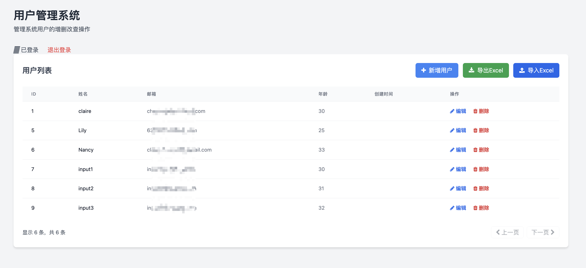
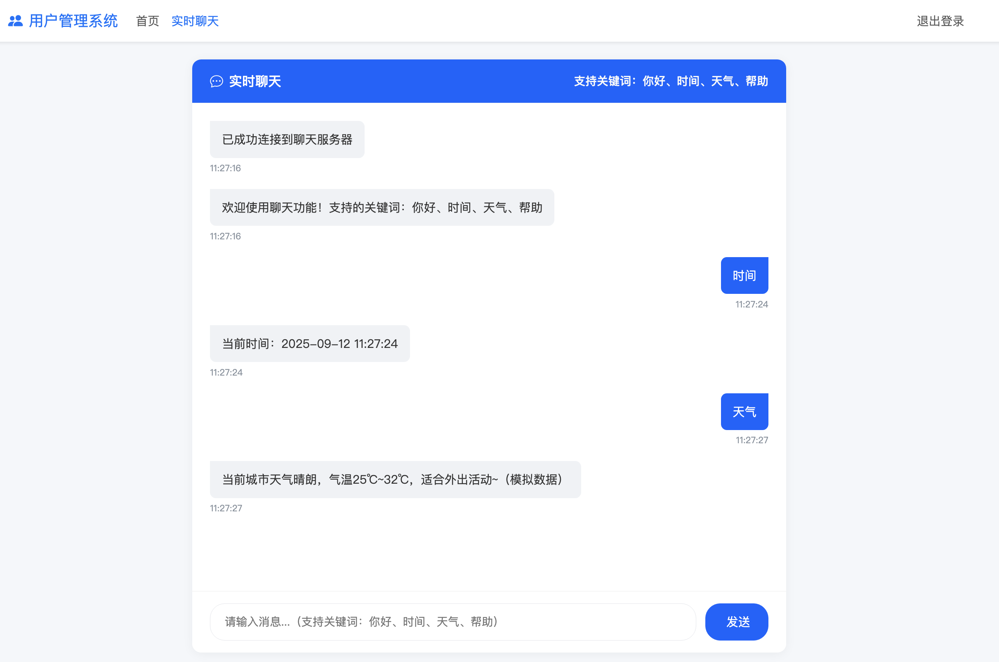

根据2025年4月TIOBE编程语言排行榜的数据，Go语言的市场份额首次突破了3%，达到了3.02%，排名全球第七位，增速显著（较上月增长1.17%），Go语言已经稳步占据了主流编程语言的一席之地，尤其是在云原生、微服务和高并发场景中备受青睐。

- [初识Go](#初识go)
- [Go Web应用开发](#go-web应用开发)
  - [Gin 🆚 Beego 核心对比概览](#gin--beego-核心对比概览)
    - [✅ Gin 的优点与缺点](#-gin-的优点与缺点)
    - [✅ Beego 的优点与缺点](#-beego-的优点与缺点)
  - [Go + Gin 初体验](#go--gin-初体验)
  - [抽离配置文件](#抽离配置文件)
  - [Sqlite 作为数据库支撑](#sqlite-作为数据库支撑)
  - [Redis 引入cache缓存](#redis-引入cache缓存)
  - [标准化日志输出 logrus](#标准化日志输出-logrus)
  - [引入登录 session 的功能](#引入登录-session-的功能)
  - [尝试文件的上传与下载](#尝试文件的上传与下载)
  - [尝试利用 WebSocket 搭建在线聊天](#尝试利用-websocket-搭建在线聊天)

## 初识Go

| 维度           | 优点                                                                                              | 缺点                                                                                              |
| :------------- | :-------------------------------------------------------------------------------------------------- | :-------------------------------------------------------------------------------------------------- |
| **并发性能**   | **卓越的高并发处理能力**：Goroutine和Channel机制，用简单的方式实现高性能。 | -                                                                                                 |
| **性能与部署** | **高性能与编译部署优势**：编译型语言，执行速度快；编译为单一二进制文件，部署简单。         | -                                                                                                 |
| **开发效率**   | **语法简洁，学习曲线平缓**：语法清晰简单，工具链完善（如 gofmt, go mod）。                  | **错误处理略显冗长**：需大量使用 `if err != nil`。                                 |
| **标准库与生态** | **强大的网络标准库**：`net/http` 包功能强大。                                      | **框架生态偏“轻量化”**：与Python的Django或Java的Spring等“全能型”框架相比，Go的框架（如Gin, Echo）更轻量。 |
| **可维护性**   | **代码格式统一**：gofmt工具强制统一代码格式。                                                | **泛型支持待完善**：虽然Go 1.18引入了泛型，但其生态和应用仍需时间发展和成熟。                         |
| **其他方面**   | **良好的跨平台支持**                                                                 | **处理动态内容能力相对较弱**                                                                   |

Go语言在以下场景中尤其能发挥其优势：
*   **高性能API服务和中间件**：特别是在**云原生和微服务架构**中，Go是许多核心基础设施（如Docker, Kubernetes）的实现语言。
*   **需要处理大量并发连接**的应用，如实时通信系统、消息推送平台。
*   **命令行工具**、**网络工具**、**数据处理管道**等需要高性能和快速部署的场景。

从常见的WEB应用的角度，了解Go语言

## Go Web应用开发

### Gin 🆚 Beego 核心对比概览

好的，我们来对 Go 语言中这两个非常流行但设计哲学截然不同的框架 **Gin** 和 **Beego** 做一个详细的对比。

这是一个非常经典的 **“微内核”** 与 **“全栈式”** 框架的对比。

| 特性维度 | Gin (微内核/高性能) | Beego (全栈式/全能型) |
| :--- | :--- | :--- |
| **设计哲学** | **专注**、**轻量**、**高性能** | **全能**、**内置齐全**、**开箱即用** |
| **定位** | **HTTP API 框架** | **全栈 Web 框架** (MVC) |
| **路由性能** | ⭐⭐⭐⭐⭐ **极快** (基于 Radix Tree) | ⭐⭐⭐⭐ **很快** (基于 Trie Tree) |
| **学习曲线** | ⭐⭐ **平缓** (API 简洁直观) | ⭐⭐⭐ **稍陡** (需要理解模块和MVC概念) |
| **功能内置** | **极少** (仅有路由、中间件等核心) | **极其丰富** (ORM, Session, 缓存, 日志, 配置等) |
| **灵活性** | ⭐⭐⭐⭐⭐ **极高** (可自由组合第三方库) | ⭐⭐⭐ **中等** (遵循框架约定，内置组件耦合) |
| **开发效率** | ⭐⭐⭐ **中** (需要自己选型和集成组件) | ⭐⭐⭐⭐⭐ **高** (内置一切，快速开始) |
| **适用场景** | 高性能 API、微服务、中间件、需要高度定制 | 全栈 Web 应用、快速业务开发、单体应用 |

---

#### ✅ Gin 的优点与缺点
 
 **优点：**

1.  **极致性能**：这是 Gin 最大的招牌。它的路由性能在 Go 框架中名列前茅，非常适合构建高性能、高并发的 API 服务和微服务。
2.  **轻量级与简洁**：代码库小巧，API 设计非常清晰直观，没有多余的抽象，让人一眼就能看懂。
3.  **强大的中间件支持**：拥有极其丰富的生态，有大量高质量、功能各异的第三方中间件可供选择（如 JWT, CORS, Rate-limiting 等）。它自身的中间件机制也非常易于使用和编写。
4.  **灵活性极高**：它只提供核心的 HTTP 功能，不绑定任何特定的数据库、ORM 或模板引擎。你可以自由选择最适合你项目的第三方库（如 GORM, sqlx, html/template 等），组装成你想要的架构。
5.  **社区活跃，生态繁荣**：目前是 Go 社区最受欢迎、使用最广泛的 Web 框架，拥有最大的生态系统和用户群体，问题容易得到解答。

**缺点：**

1.  **“自带电池”程度低**：需要自己做大量的技术选型和集成工作。要构建一个完整的应用，你需要自己组合路由、ORM、日志、配置管理等库，这增加了初期的决策成本。
2.  **更偏向 API 开发**：虽然也可以渲染模板，但它没有内置强大的 MVC 结构和相关的开发工具，构建传统的全栈 Web 应用（前后端不分离）不如 Beego 那么“一站式”。

---

#### ✅ Beego 的优点与缺点

**优点：**

1.  **开箱即用，功能全面**：这是 Beego 最大的优势。它提供了构建一个完整 Web 应用所需的一切：ORM、Session 管理、缓存、日志、配置解析、HTTP 客户端等。你不需要为选择这些工具而烦恼。
2.  **高效的开发体验**：内置的 `bee` 工具链非常强大，支持热编译、项目脚手架生成、数据库迁移、自动化测试和部署等，能显著提升开发效率，尤其适合业务驱动的快速开发。
3.  **清晰的 MVC 架构**：为大型项目提供了清晰的项目结构规范（Models, Views, Controllers, Routers），有利于团队协作和长期维护。
4.  **健壮性和可观测性**：内置了监控、性能分析工具，可以方便地查看应用状态、性能指标和 API 统计信息。

**缺点：**

1.  **性能相对较低**：虽然性能依然很好（毕竟是 Go 语言），但由于功能更重、抽象更多，在纯路由性能的基准测试上通常会略低于 Gin 这样的极简框架。
2.  **灵活性较差，耦合性高**：框架的各个部分耦合度相对较高。如果你不喜欢它内置的 ORM (`beego/orm`) 或日志组件，想换成 GORM 或 zap，会比较麻烦，不如 Gin 那样自由。
3.  **学习成本稍高**：你需要学习和理解 Beego 自己的一套规则和 API，而不仅仅是 Go 标准库的知识。
4.  **社区热度相对下降**：虽然仍有大量项目在使用且稳定，但社区讨论度和新兴项目的采用率上，目前不如 Gin 活跃。

---

### Go + Gin 初体验

参考常规WEB应用，搭建分层架构

- 入口文件（main.go）：应用的启动点，负责初始化配置、连接数据库、设置依赖注入和启动服务器
- 配置层（config）：处理应用配置，支持从配置文件和环境变量读取
- 数据访问层（repository）：负责与数据库交互
- 业务逻辑层（service）：实现核心业务逻辑
- 控制器层（controller）：处理 HTTP 请求和响应
- 路由层（routes）：定义 API 路由
- 中间件（middleware）：提供通用功能，如日志、跨域处理等
- 模型层（model）：定义数据结构和错误类型

**初始化项目**

初始化项目：

```bash
go mod init example/webapp
```

安装依赖：

```bash
go mod tidy
```

运行应用：

```bash
go run main.go
```

清理模块缓存：

```bash
go clean -modcache
```

清理编译缓存:

```bash
go clean -cache -webapp
```



### 抽离配置文件

配置为`config.yaml`, 配置的引入为`config.do`

YAML是我们在Java应用中常见的应用配置的格式，在Go这边规范化的配置文件也是推荐YAML

- 可读性好，结构清晰，支持注释。
- 支持嵌套结构，适合复杂配置（如数据库、日志、第三方服务等）。
- 与 Docker、Kubernetes 等云原生工具链天然契合。
- 大量 Go 配置库（如 viper）对 YAML 支持非常好。

常用库：spf13/viper（强烈推荐）

### Sqlite 作为数据库支撑

SQLite 是一个开源的嵌入式关系数据库，实现自包容、零配置、支持事务的SQL数据库引擎。其特点是高度便携、使用方便、结构紧凑、高效、可靠。 只要确保SQLite的二进制文件存在即可开始创建、连接和使用数据库。

**驱动**

* https://github.com/mattn/go-sqlite3 支持database/sql接口

`user_repository`中通过 `InitDB` 的方法对数据库进行初始化

通过手写SQL或者预编译SQL的常见方式，进行数据库查询

### Redis 引入cache缓存

Go目前支持redis的驱动有如下
* https://github.com/gomodule/redigo (推荐)
* https://github.com/go-redis/redis
* https://github.com/hoisie/redis
* https://github.com/alphazero/Go-Redis
* https://github.com/simonz05/godis

使用redigo驱动连接缓存

`redis_cache.go`中实现了`InitCache`方法对Redis连接池进行初始化

通过connection.do方法执行redis命令

### 标准化日志输出 logrus

logrus是用Go语言实现的一个日志系统，与标准库log完全兼容并且核心API很稳定,是Go语言目前最活跃的日志库

`logger.go`能够规范化日志输出格式，最终调用logrus的API进行日志输出

```go
	logger.GetLogger().WithError(err).WithFields(logrus.Fields{
			"trace_id": traceID,
		}).Error("获取用户列表失败")
```

### 引入登录 session 的功能

Web里面经典的解决方案是cookie和session，cookie机制是一种客户端机制，把用户数据保存在客户端，而session机制是一种服务器端的机制，服务器使用一种类似于散列表的结构来保存信息，每一个网站访客都会被分配给一个唯一的标志符，即sessionID。

`auth.go`中就实现了session的维护、获取和校验功能，引入Redis缓存来存储session数据，更符合微服务或分布式应用的需求

`router.go`中，对于需要认证保护的路由，我们可以使用`AuthRequired`中间件进行保护

### 尝试文件的上传与下载

文件的上传下载与Java的实现类似，都是通过HTTP协议进行文件的传输

依赖 `"github.com/xuri/excelize/v2"` 进行常规Excel的处理

文件导出： `excelize.NewFile()` 后自定义表头并填入数据，最后将文件写入http响应流，结合前端技术实现Excel下载

文件导入： 从前端表格中获取文件流，保存到临时文件，然后使用`excelize.OpenFile(tempPath)` 打开文件，解析并读取数据

### 尝试利用 WebSocket 搭建在线聊天

WebSocket解决了Web实时化的问题，相比传统HTTP有如下好处：
* 一个Web客户端只建立一个TCP连接
* Websocket服务端可以推送(push)数据到web客户端.
* 有更加轻量级的头，减少数据传送量

使用`"github.com/gorilla/websocket"` 库实现WebSocket的服务端和客户端

`websocket_handler.go` 中实现了WebSocket的服务端和客户端的处理逻辑

`routers.go`中需要对websocket的形式指定handler: `r.GET("/ws/chat", middleware.AuthRequired(), handler.WebSocketHandler)`

前端页面同步实现eventlistener，即可通过websocket协议，进行前后端对话

