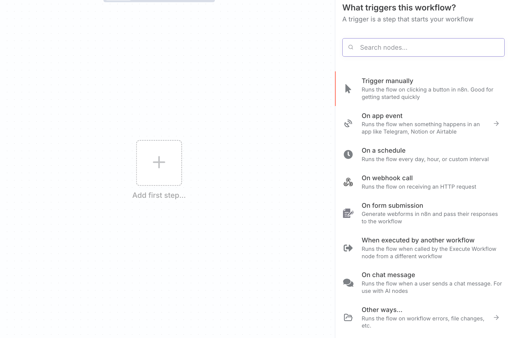
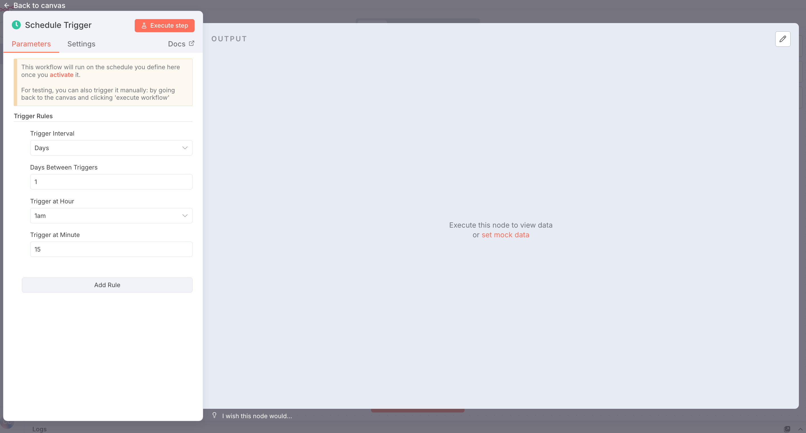
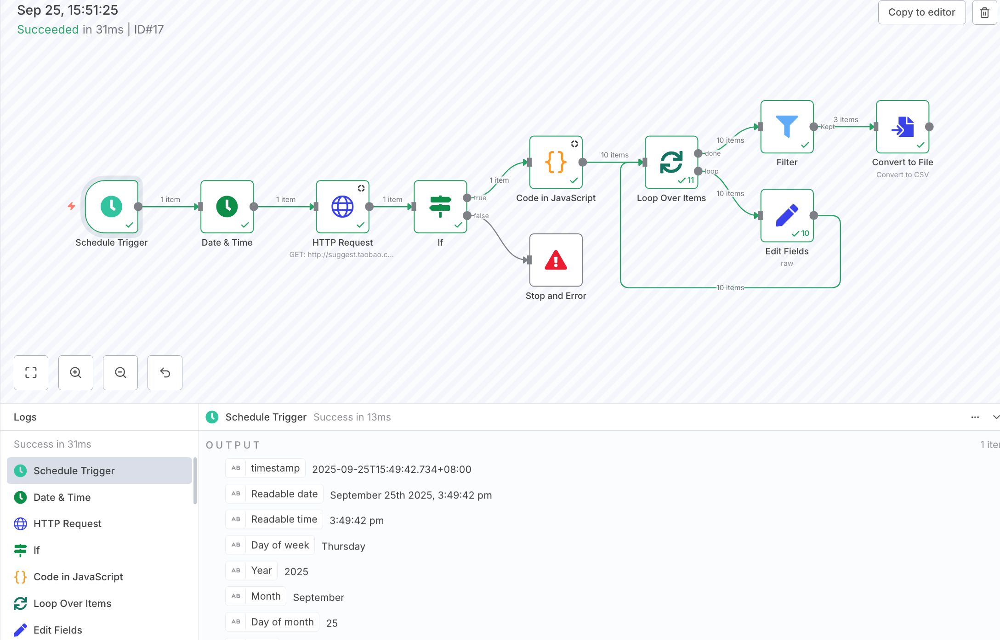

- [什么是n8n，为什么用它？](#什么是n8n为什么用它)
- [docker 安装](#docker-安装)
- [测试一个工作流](#测试一个工作流)
- [关键概念](#关键概念)
  - [流程逻辑](#流程逻辑)
    - [使用条件分割](#使用条件分割)
    - [合并数据](#合并数据)
    - [循环](#循环)
    - [等待](#等待)
    - [子工作流](#子工作流)
    - [错误处理](#错误处理)
    - [多分支工作流中的执行顺序](#多分支工作流中的执行顺序)
- [数据](#数据)
  - [数据结构](#数据结构)
  - [节点内的数据流](#节点内的数据流)
  - [转换数据](#转换数据)
  - [使用代码处理数据](#使用代码处理数据)
  - [数据映射](#数据映射)
  - [数据固定](#数据固定)
  - [数据编辑](#数据编辑)
  - [数据过滤](#数据过滤)
  - [数据模拟](#数据模拟)
  - [数据表](#数据表)
  - [二进制数据](#二进制数据)
- [代码参数](#代码参数)


## 什么是n8n，为什么用它？

n8n 是一个 工作流自动化工具s，核心是帮你连接和集成各种不同的应用与服务，自动化重复的业务流程，比如数据同步、消息通知或跨系统任务触发。

自动化业务流程，例如在不同的数据库和SaaS应用（如Slack, Shopify, Notion）之间同步数据、设置事件提醒、或自动化重复性的任务。你希望的是“如果发生A，就执行B”这类的自动化。

2019年发展至今，从Github上看这个项目成爆发式增长，它的主要优势有：
- 低代码/无代码：通过拖拽节点和配置参数，无需编写大量代码即可构建自动化流程。
- 由事件驱动：很多工作流由Webhook（如收到一封邮件、一个表单提交）即时触发，适合需要实时响应的场景。
- 易于调试：图形化界面让整个数据流清晰可见，可以轻松查看每个节点的输入和输出，快速定位问题。

其成功的“点”主要有：

**顺应AI浪潮，成为“AI应用的Excel”**

n8n的爆发式增长（8个月营收增长4倍）恰逢AI Agent兴起。企业不再满足于单一AI功能，而是需要将多个AI工具、数据源、业务系统串联编排。n8n的可视化工作流天然适合构建复杂的AI代理（Agent），用户无需写代码即可搭建“AI员工”。而Jenkins/Zabbix并未深度融入AI场景。

**“零代码”革命，打破技术壁垒**

Jenkins和Zabbix本质上是为开发者服务的工具，而n8n是为业务人员赋能的平台。它让HR、销售等非技术人员也能自主创建自动化流程（如自动筛简历、抓取竞品数据），极大释放了组织效率。这种“平民化”是其病毒式传播的关键。

**开源 + Fair Code 策略，构建强大社区生态**

n8n采用“公平代码”（Fair Code）开源模式，基础功能免费，企业版收费。这吸引了超过23万活跃用户和74万GitHub星标。社区用户自发创作教程、贡献Node节点，形成正向飞轮：用户越多 → 内容越多 → 工具越强大 → 吸引更多用户。而Jenkins虽开源，但社区更偏向技术讨论，缺乏n8n这种“全民共创”的生态。

**聚焦“业务价值”而非“技术实现”**

n8n解决的是“如何让工作更省力”的问题，直接关联业务成果（如客服咨询处理率提升70%）。而Jenkins/Zabbix解决的是“如何让系统更稳定”的技术问题。前者更容易被管理层和一线员工广泛接受，市场空间更大。

**数据安全与合规优势**

n8n支持自托管，数据完全掌握在企业自己手中。这对于Vodafone等重视数据隐私的欧洲企业极具吸引力，使其在欧盟市场成为“合规首选”，与硅谷SaaS工具形成差异化竞争。

## docker 安装

n8n 推荐使用 Docker 进行大多数自托管需求。它提供了一个干净、独立的环境，避免了操作系统和工具的不兼容，并使数据库和环境管理变得更简单。

```bash
#创建一个卷来存储持久数据，下载所需的n8n镜像，并使用以下设置启动容器
docker volume create n8n_data

docker run -it --rm \
 --name n8n \
 -p 5678:5678 \ 
 -e GENERIC_TIMEZONE="Asia/Shanghai" \
 -e TZ="Asia/Shanghai" \
 -e N8N_ENFORCE_SETTINGS_FILE_PERMISSIONS=true \
 -e N8N_RUNNERS_ENABLED=true \
 -v n8n_data:/home/node/.n8n \
 docker.n8n.io/n8nio/n8n

……

Finished migration LinkRoleToUserTable1750252139168
Starting migration RemoveOldRoleColumn1750252139170
Finished migration RemoveOldRoleColumn1750252139170
Starting migration AddInputsOutputsToTestCaseExecution1752669793000
Finished migration AddInputsOutputsToTestCaseExecution1752669793000
Starting migration LinkRoleToProjectRelationTable1753953244168
Finished migration LinkRoleToProjectRelationTable1753953244168
Starting migration CreateDataStoreTables1754475614601
Finished migration CreateDataStoreTables1754475614601
Starting migration ReplaceDataStoreTablesWithDataTables1754475614602
Finished migration ReplaceDataStoreTablesWithDataTables1754475614602

There are deprecations related to your environment variables. Please take the recommended actions to update your configuration:
 - DB_SQLITE_POOL_SIZE -> Running SQLite without a pool of read connections is deprecated. Please set `DB_SQLITE_POOL_SIZE` to a value higher than zero. See: https://docs.n8n.io/hosting/configuration/environment-variables/database/#sqlite
 - N8N_BLOCK_ENV_ACCESS_IN_NODE -> The default value of N8N_BLOCK_ENV_ACCESS_IN_NODE will be changed from false to true in a future version. If you need to access environment variables from the Code Node or from expressions, please set N8N_BLOCK_ENV_ACCESS_IN_NODE=false. Learn more: https://docs.n8n.io/hosting/configuration/environment-variables/security/

n8n Task Broker ready on 127.0.0.1, port 5679
[license SDK] Skipping renewal on init: license cert is not initialized
Registered runner "JS Task Runner" (srY2MbqfDfCtg2_d8oGMk) 
Version: 1.112.5

Editor is now accessible via:
http://localhost:5678

Press "o" to open in Browser.
 ```

- 映射并暴露主机上的端口5678
- 为容器设置时区
- 强制执行n8n配置文件的安全文件权限
- 启用任务运行器，这是在n8n中执行任务的推荐方式
- 将n8n_data卷挂载到/home/node/.n8n目录，以便在容器重启时保持数据持久性

默认情况下，n8n使用SQLite来保存凭据、过去的执行和工作流，如需要持久化可以考虑PostgreSQL

访问 n8n： `http://localhost:5678`

此外还有Cloud方案和npm安装方案，这边省略了，可自行查询[官方说明](https://docs.n8n.io/hosting/installation/npm/#try-n8n-with-npx)

## 测试一个工作流





配置步骤：
- 第一步：创建新工作流：首页显示可以选择【从头开始】以创建新工作流，或者选择【预编译】的工作流
- 第二步：添加触发器节点：在工作流中添加一个触发器节点，例如 手动触发器、定时触发器、HTTP 触发器、Webhook 触发器等。配置好基本属性，选择返回默认暂存，双击打开编辑，右键可以执行更多操作
- 第三步：添加内置节点并设置凭据。常规的HTTP接口、AI接口都会有这个步骤
- 第四步：使用 If 节点添加逻辑。主用用于一些条件判断，对于正常的流程继续流转，对于异常的流程告警提示等。或者可融入业务逻辑，进行数据判断。
- 第五步：从工作流输出数据。可将结果输出到文件或其他服务，如 Telegram、Slack、Email 等。常见一些统计、分析、告警等。
- 第六步：测试工作流




 ## 关键概念

### 流程逻辑

#### 使用条件分割

`IF/SWITCH` 节点用于根据条件执行不同的分支。可以设置多个条件，每个条件对应一个分支。如果没有条件匹配，可选是否执行默认分支。

#### 合并数据

`MERGE` 合并将多个数据流汇聚在一起。您可以根据工作流要求使用不同的节点来实现这一点。

- 合并来自不同数据流或节点的数据：使用 `Merge` 节点将来自各种源的数据合并为一个。
- 合并来自多个节点执行的数据：对于需要合并来自一个节点的多次执行或多个节点的数据的复杂场景，使用 `Code` 节点。
- 比较和合并数据：使用 `Compare Datasets` 节点根据比较来比较、合并和输出数据流。

#### 循环

-  使用 `IF` 节点实现循环
-  `Loop Over Items` 节点在所有传入项目被分成批次并传递给工作流中的下一个节点后停止执行，因此无需添加 `IF` 节点来停止循环
  
#### 等待

让工作流等待使用 `Wait` 节点

#### 子工作流

- 打开您想要调用子工作流的工作流。
- 添加执行子工作流节点。
- 在执行子工作流节点中，设置您想要调用的子工作流。您可以选择通过 ID 调用工作流、从本地文件加载工作流、将工作流 JSON 作为节点中的参数添加，或通过 URL 定位工作流。
- 查找您的工作流 ID
-  您的子工作流 ID 是其 URL 末尾的字母数字字符串。
- 填写子工作流定义的必需输入数据项。
-  保存您的工作流。

#### 错误处理

使用 `Stop And Error` 节点显示自定义错误消息，在特定条件下使执行失败，并将自定义错误信息发送到错误工作流。

#### 多分支工作流中的执行顺序

## 数据

###  数据结构

节点之间传递的所有数据都是对象数组

```json
[
	{
		// 对于大多数数据：
		// 将每个项目包装在另一个对象中，键为 'json'
		"json": {
			// 示例数据
			"apple": "beets",
			"carrot": {
				"dill": 1
			}
		},
		// 对于二进制数据：
		// 将每个项目包装在另一个对象中，键为 'binary'
		"binary": {
			// 示例数据
			"apple-picture": {
				"data": "....", // Base64 编码的二进制数据（必需）
				"mimeType": "image/png", // 如果可能的话最好设置（可选）
				"fileExtension": "png", // 如果可能的话最好设置（可选）
				"fileName": "example.png", // 如果可能的话最好设置（可选）
			}
		}
	},
]
```
### 节点内的数据流
### 转换数据

如果获取了来自互联网的数据，格式可能多种多余，可以使用数据转换节点进行数据的调整：

- 聚合：获取单独的项目或其部分，并将它们组合成单个项目。
- 限制：删除超出定义最大数量的项目。
- 去重：识别并删除在所有字段或字段子集中相同的项目。
- 排序：按所需顺序组织列表，或生成随机选择。
- 拆分：将包含列表的单个数据项分离为多个项目。
- 汇总：将项目聚合在一起，类似于 Excel 数据透视表的方式。

### 使用代码处理数据

使用 `Code` 来处理数据就是非常灵活的，JS和Python的的代码都可以支持

### 数据映射


### 数据固定

数据固定意味着保存节点的输出数据，并在将来的工作流执行中使用保存的数据而不是获取新数据

### 数据编辑

编辑固定数据。这意味着您可以检查不同的场景，而无需设置每个场景并从外部系统发送相关数据。这使测试边缘情况变得更容易。

### 数据过滤

在节点的输入和输出面板中搜索和过滤数据。使用此功能检查节点的数据

### 数据模拟
数据模拟是模拟或伪造数据

### 数据表

使用数据表，你可以直接在工作流内保存、管理和交互数据，无需依赖外部数据库系统

### 二进制数据

二进制数据是任何文件类型的数据，例如图像文件或文档

## 代码参数

代码这部分属于灵活性最高的，你可以在代码中使用任何JS或Python的代码来处理数据。除了了解基本JS和Python的语法外，你需要对上下流程获取和回写的结构有所了解，内置便利的数据转换函数，包含对数组、布尔值、日期、数字、对象、字符串的处理。